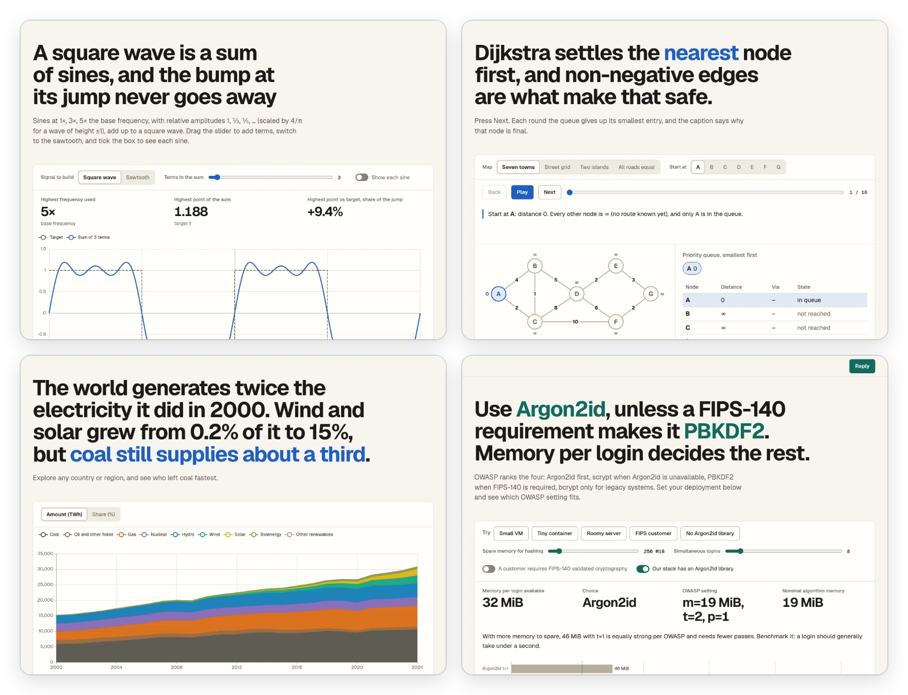
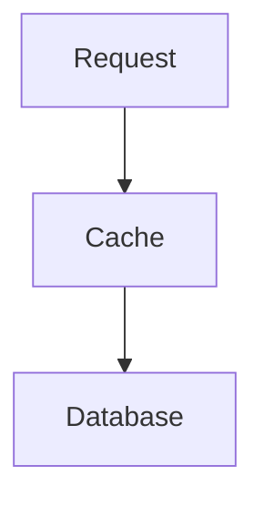
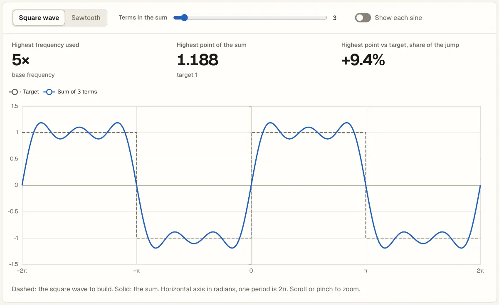
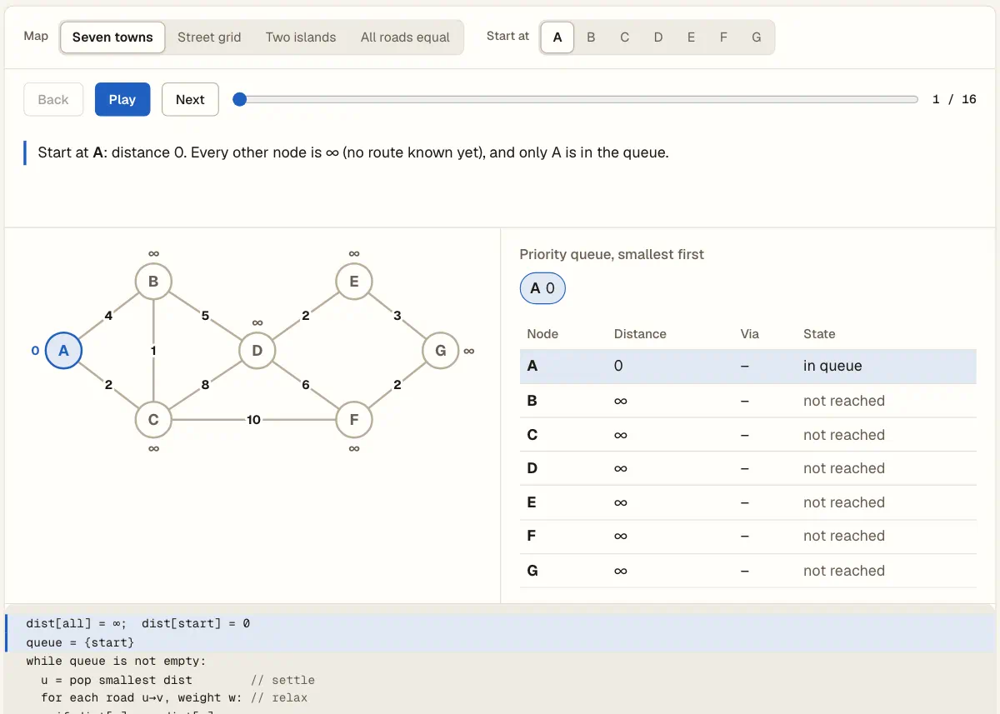
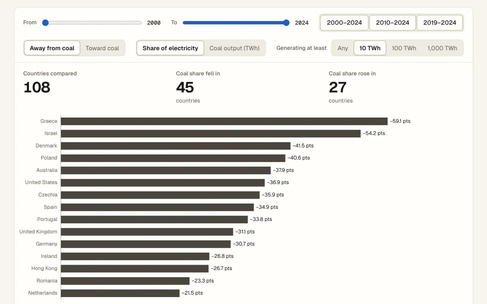
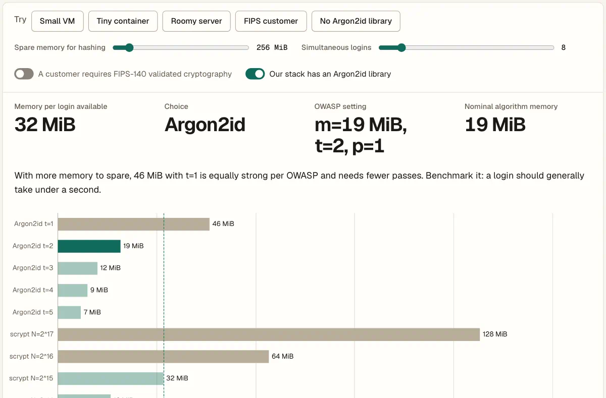

# Explainer

An agent skill that turns "show me" into one interactive HTML page: charts to explore, step-through explanations, diagrams that light up from the text, drill-down views, and questions the reader answers on the page. The page is a single file that works offline from `file://`, in light and dark, on desktop and phone.

<a href="https://barisgit.github.io/explainer-skill/">
<picture>
  <source media="(prefers-color-scheme: dark)" srcset="examples/media/hero-dark.webp">
  
</picture>
</a>

**Live examples**, each written by an agent following the skill: [Fourier series](https://barisgit.github.io/explainer-skill/fourier-series/) (study page), [Dijkstra's algorithm](https://barisgit.github.io/explainer-skill/dijkstra/) (step-through), [World electricity mix](https://barisgit.github.io/explainer-skill/electricity-mix/) (data explorer), [Choosing a password hash](https://barisgit.github.io/explainer-skill/password-hashing/) (decision page). Sources are in [`examples/`](examples/).

## Why

In order of priority:

1. **The reader understands and takes in the subject.** This comes before everything else; looks and interactivity serve it. [`guide.md`](skills/explainer/guide.md) records what made generated pages better or worse for their readers, and the kit's house style keeps the eye on the content.
2. **Agents write pages easily, and the source stays readable for the agent who edits it later.** A page is MDX: prose in Markdown, and charts, sliders, steppers, drill-down views and questions as one tag each over data the page imports, so the agent writes the content and its data rather than the machinery.
3. **The page is one portable file that works offline and stays small enough.** Necessary, but the least important of the three. `pack` renders the page to static HTML, inlines only the kit scripts it uses (ECharts, about 0.4 MB compressed and unpacked as the page loads, only for pages that use it), and draws Mermaid diagrams as SVG and formulas as MathML, so no diagram or math library ships.

## Install

Both installers copy `skills/explainer/` as it is.

**npx skills** ([vercel-labs/skills](https://github.com/vercel-labs/skills))

```sh
npx skills add barisgit/explainer-skill --global --agent claude-code --agent codex -y
```

Several agents share one copy in `~/.agents/skills/explainer` and the others get symlinks; add `--copy` to give each agent its own copy. Without `--global` the skill goes into the current project. A local checkout works too: pass its path instead of `barisgit/explainer-skill`.

**Caplet** (verified with `caplet` 0.1.0)

```sh
caplet add github:barisgit/explainer-skill --pin main --scope user
```

Caplet needs a ref for GitHub sources. `main` follows the latest commit on each `caplet update`; pin a tag such as `v0.12.1` instead to hold a version.

Caplet copies the skill into `~/.agents/skills/explainer`, gives it to Claude Code as a plugin, and records the source in `~/.agents/capabilities.yml`. For one project, run `caplet init` in it, then `caplet add <source> --scope project`. A local checkout works too: `caplet add <path> --scope user`.

Use one installer per machine: both write `~/.agents/skills/explainer`, and Caplet does not warn when another source already emits a skill of the same name. `bun ~/.agents/skills/explainer/cli.ts kit` checks an installed copy.

**Requirements:** [Bun](https://bun.sh) (verified with 1.4.3), and Google Chrome or Chromium for `check` (`CHROME=/path/to/chrome` if it is not found; a build downloaded by agent-browser or Playwright also works). Nothing else is installed: the skill runs as copied.

<details>
<summary>Update and uninstall</summary>

```sh
npx skills update explainer --global                                     # GitHub source
npx skills add <path> --global --agent claude-code --agent codex -y      # local checkout: add again
caplet update explainer --scope user                                    # re-reads the source and applies

npx skills remove explainer --global -y
caplet remove explainer --scope user && caplet apply --scope user
```

`npx skills update` cannot check a local path, and plain `caplet apply` reuses the snapshot of a local source, so use the commands above after changing a checkout.

</details>

## How it works

The agent reads [`SKILL.md`](skills/explainer/SKILL.md) and drives a small CLI, run as `bun <skill directory>/cli.ts`:

1. **Write** `page.mdx`: Markdown prose, the kit's components (`Chart`, `Plot`, `Explore`, `Stepper`, `View`, `Records`, `Table`, `Question`) and the `.ts` or `.json` data it imports. `kit` lists what is available and `kit <name>` documents one; a `.tsx` component whose first line is `"use client"` covers behaviour no component does.
2. **Pack**: `pack page.mdx -o out.html` renders the page to static HTML, inlines the kit scripts it uses, the fonts and local assets, and draws the Mermaid diagrams (one SVG each, following light and dark) and TeX formulas, so the result is one offline file.
3. **Check**: `check out.html` opens it in headless Chrome in light and dark at 1440 and 390 px wide, scrolls it end to end, reports errors, network use and clipped or overflowing content, and saves screenshots for the agent to look at. `--do` clicks, presses keys, types and sets fields first, so the screenshots can show a later state, and `--do shot:<css>` saves one element at that point.

A diagram whose parts light up from the text, for illustration:

````mdx


1. <span data-ref="req">A request</span> arrives.
2. <span data-ref="cache">The cache</span> misses.
3. <span data-ref="db">The database</span> answers.
````

## What a page can use

**Charts that redraw as the reader moves a control.** `Explore` puts a slider, switch or toggles over a plot or chart, from frames computed when the page packs; ECharts in the page theme has zoom, legend toggles and click-to-drill, and the light `Plot` draws a few small plots without it.

<picture>
  <source media="(prefers-color-scheme: dark)" srcset="examples/media/fourier-series-terms-dark.webp">
  
</picture>

**Step-through figures.** Back, Play, Next, a scrubber and arrow keys from one `Stepper`; HTML, hand-built SVG parts and captions step together.

<picture>
  <source media="(prefers-color-scheme: dark)" srcset="examples/media/dijkstra-steps-dark.webp">
  
</picture>

**Drill-down views.** A hash router inside the one file, one `View` per record or one filled from data: a bar, row or link opens its own view, and Back returns with the scroll position kept. The page's links give each view breadcrumbs and previous and next, pages with views inside views a contents rail, and a section with several folds Expand all.

**Record trees.** Nested records (phases, groups, items) as one complete list that opens level by level: a summary line per level with its numbers aligned, Expand all for every level, and links from the text that open the branch they name.

<picture>
  <source media="(prefers-color-scheme: dark)" srcset="examples/media/electricity-mix-coal-ranking-dark.webp">
  
</picture>

**Questions the reader answers.** A `Question` checks a choice on the spot, takes a written answer, or joins one Markdown reply the reader sends back to the agent, together with notes on selected text or diagram parts. Inputs and notes survive a reload; a Clear button starts the answers over.

<picture>
  <source media="(prefers-color-scheme: dark)" srcset="examples/media/password-hashing-presets-dark.webp">
  
</picture>

Also in the kit: Mermaid diagrams written as ```` ```mermaid ```` fences and drawn at pack time (flowchart, state, sequence, class, ER and xychart), TeX formulas drawn as MathML with no script, tables computed from data, linked highlighting between prose, table rows and diagram parts, a stylesheet that follows the system's light or dark setting, and the kit's own buttons and messages in the page's language (`kit labels` prints them to translate).

[`skills/explainer/example/`](skills/explainer/example/page.mdx) (`page.mdx` and the files it imports) is one short page that uses the kit where it helps its subject.

## Development

```sh
bun install               # dev tools and the git hook
bun run ci                # typecheck, lint (Biome), tests; what GitHub Actions runs
bun run media             # regenerates the README and gallery media from examples/ (Chrome, ffmpeg)
bun run verify:install    # before a release: installs with both installers into a temp HOME (network, Chrome)
```

Layout, decisions and limits are in [AGENTS.md](AGENTS.md). The examples are published from `examples/` by `.github/workflows/pages.yml`.

## Credits

- [visual-explainer](https://github.com/nicobailon/visual-explainer) by Nico Bailon (MIT): the look and the reply flow.
- [Apache ECharts](https://echarts.apache.org) (Apache-2.0), bundled in the kit.
- [beautiful-mermaid](https://github.com/lukilabs/beautiful-mermaid) by Craft Docs (MIT), patched, with [ELK](https://github.com/kieler/elkjs) (EPL-2.0) and [entities](https://github.com/fb55/entities) (BSD-2-Clause): the Mermaid renderer `pack` uses, not shipped in pages.
- [Preact](https://preactjs.com) and preact-render-to-string (MIT): the components and their hydration; [MDX](https://mdxjs.com) (MIT) with its unified, remark and micromark packages (MIT, one ISC), used by `pack`, not shipped in pages.
- [Temml](https://temml.org) by Ron Kok (MIT) with remark-math, micromark-extension-math and mdast-util-math (MIT): TeX to MathML in `pack`; `temml.woff2` is from the KaTeX fonts (MIT, Khan Academy).
- [TanStack Table](https://tanstack.com/table) by Tanner Linsley (MIT), with TanStack Store (MIT): the sorting, filtering, grouping and facets of `Records`.
- [Geist and Geist Mono](https://vercel.com/font) by Vercel (SIL OFL 1.1).

Licence texts are in `skills/explainer/kit/licenses/`. The examples cite their own sources; the electricity data is from [Our World in Data](https://github.com/owid/energy-data).

## Licence

MIT, see [LICENSE](LICENSE). A copy sits in `skills/explainer/` so installed copies carry it. The password hashing example adapts the OWASP Password Storage Cheat Sheet and is under CC BY-SA 4.0, as stated on the page.
