# Explainer

An agent skill that answers with a page: the finding as its headline, a figure you can move, and a question you answer on it. One HTML file that opens offline.

> “Three quotes for a home battery: 5, 10 or 15 kWh. Which one?”

<a href="https://barisgit.github.io/explainer-skill/battery/">
<picture>
  <source media="(prefers-color-scheme: dark)" srcset="examples/media/battery-hero-dark.webp">
  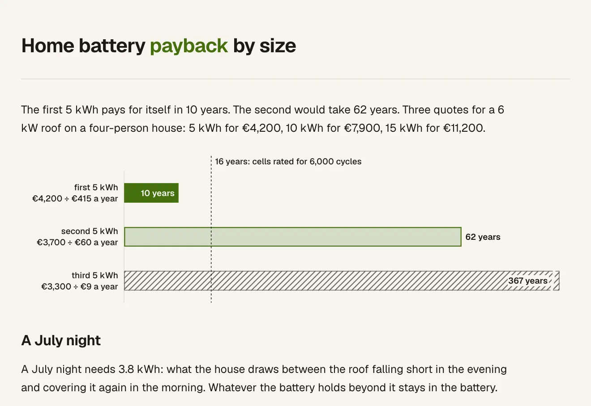
</picture>
</a>

```sh
npx skills add barisgit/explainer-skill --global --agent claude-code --agent codex -y
```

Then ask your agent to show you: “explain this pull request as a page”. [More ways to install](#install).

Six more questions, each answered with a page. The [gallery](https://barisgit.github.io/explainer-skill/) shows all seven; sources are in [`examples/`](examples/), each with the prompt it answers in `prompt.md`.

<table>
<tr>
<td width="50%" valign="top">
<a href="https://barisgit.github.io/explainer-skill/echarts-compressed/">
<picture>
  <source media="(prefers-color-scheme: dark)" srcset="examples/media/echarts-compressed-card-dark.webp">
  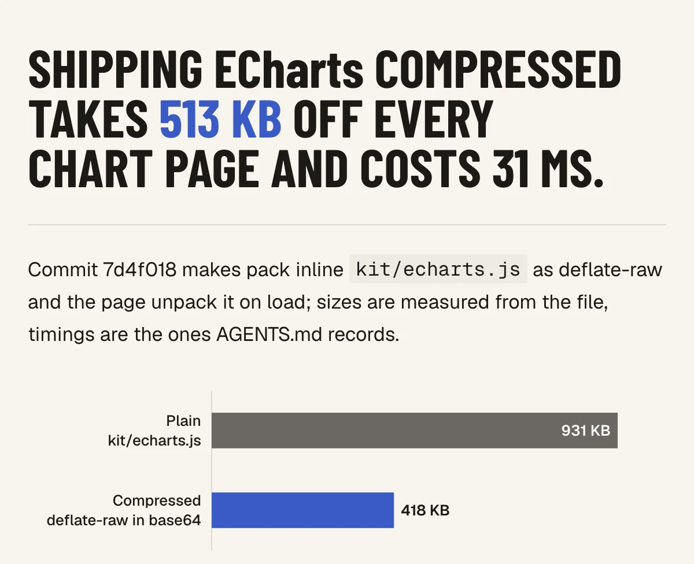
</picture>
</a>
<br><a href="https://barisgit.github.io/explainer-skill/echarts-compressed/"><b>Code review</b></a>: the change that ships ECharts compressed
</td>
<td width="50%" valign="top">
<a href="https://barisgit.github.io/explainer-skill/i2c-pull-ups/">
<picture>
  <source media="(prefers-color-scheme: dark)" srcset="examples/media/i2c-pull-ups-card-dark.webp">
  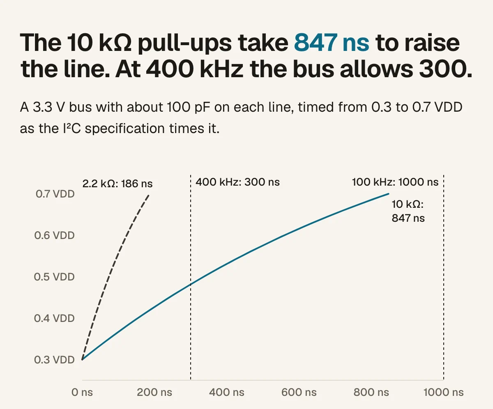
</picture>
</a>
<br><a href="https://barisgit.github.io/explainer-skill/i2c-pull-ups/"><b>Engineering page</b></a>: I²C pull-ups, with the schematic
</td>
</tr>
<tr>
<td width="50%" valign="top">
<a href="https://barisgit.github.io/explainer-skill/electricity-mix/">
<picture>
  <source media="(prefers-color-scheme: dark)" srcset="examples/media/electricity-mix-card-dark.webp">
  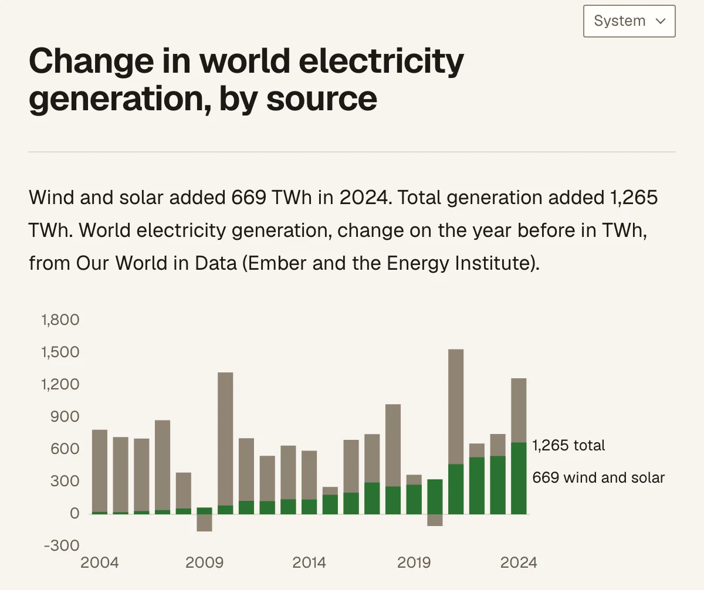
</picture>
</a>
<br><a href="https://barisgit.github.io/explainer-skill/electricity-mix/"><b>Data report</b></a>: world electricity, 223 places from Our World in Data
</td>
<td width="50%" valign="top">
<a href="https://barisgit.github.io/explainer-skill/node-modules/">
<picture>
  <source media="(prefers-color-scheme: dark)" srcset="examples/media/node-modules-card-dark.webp">
  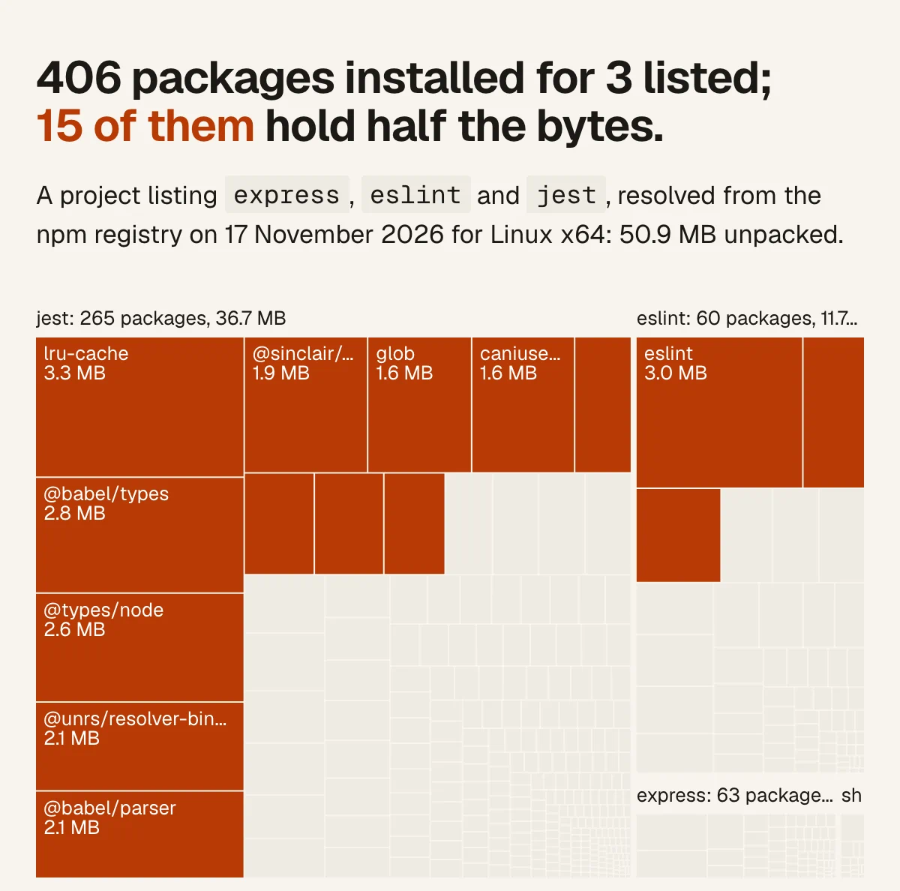
</picture>
</a>
<br><a href="https://barisgit.github.io/explainer-skill/node-modules/"><b>Drill-down over records</b></a>: what one <code>npm install</code> puts on disk
</td>
</tr>
<tr>
<td width="50%" valign="top">
<a href="https://barisgit.github.io/explainer-skill/fourier-series/">
<picture>
  <source media="(prefers-color-scheme: dark)" srcset="examples/media/fourier-series-card-dark.webp">
  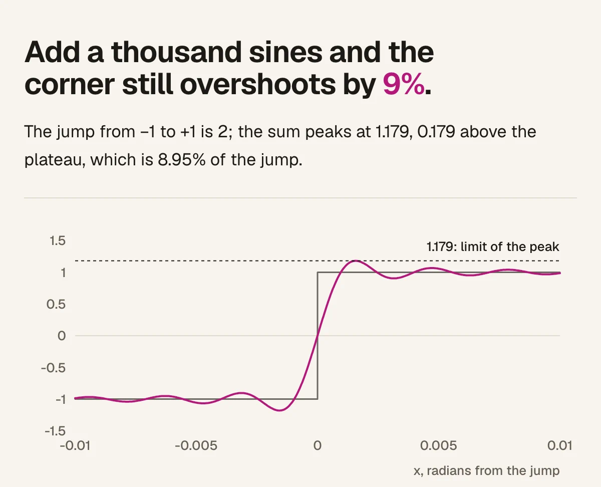
</picture>
</a>
<br><a href="https://barisgit.github.io/explainer-skill/fourier-series/"><b>Study page</b></a>: the Gibbs overshoot
</td>
<td width="50%" valign="top">
<a href="https://barisgit.github.io/explainer-skill/dijkstra/">
<picture>
  <source media="(prefers-color-scheme: dark)" srcset="examples/media/dijkstra-card-dark.webp">
  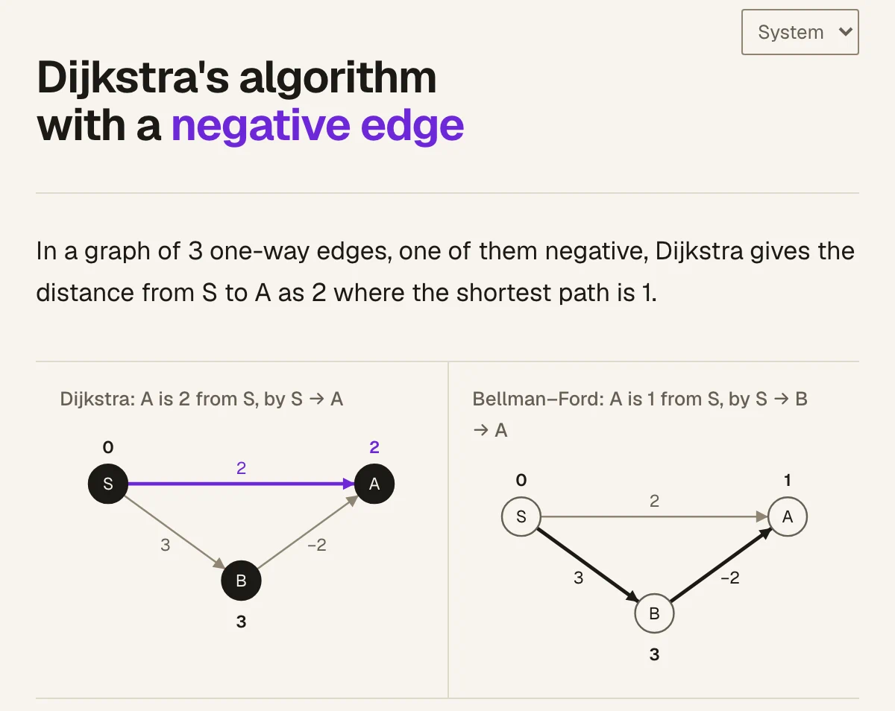
</picture>
</a>
<br><a href="https://barisgit.github.io/explainer-skill/dijkstra/"><b>Algorithm</b></a>: Dijkstra with a negative edge
</td>
</tr>
</table>

## What the reader gets

**A control where it answers a question.** A slider, switch or toggles over a figure, which moves from the state it is in.

<picture>
  <source media="(prefers-color-scheme: dark)" srcset="examples/media/fourier-series-terms-dark.webp">
  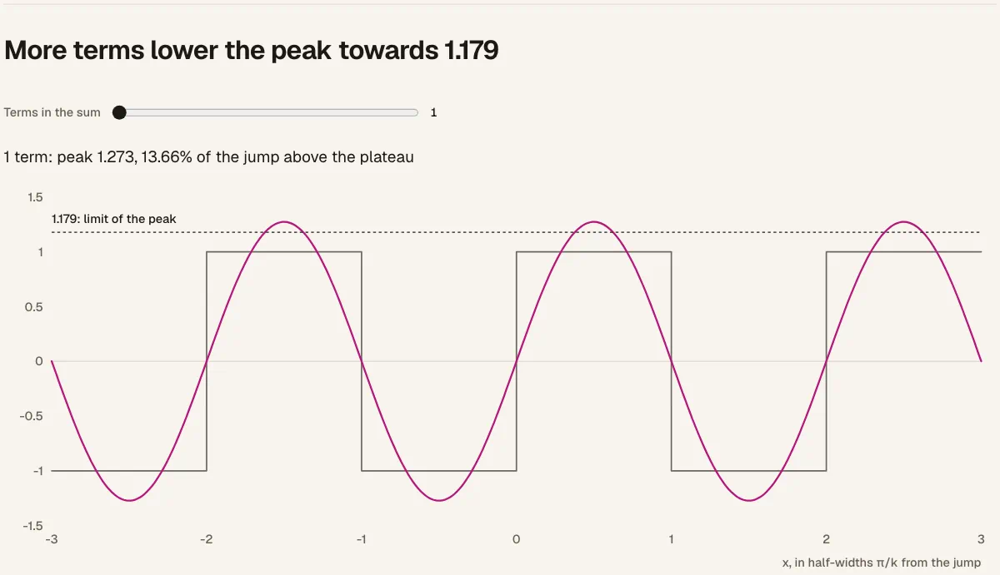
</picture>

**Marks that are the control.** A choice can be the plot's own columns: pick one and the key reads its values.

<picture>
  <source media="(prefers-color-scheme: dark)" srcset="examples/media/i2c-pull-ups-values-dark.webp">
  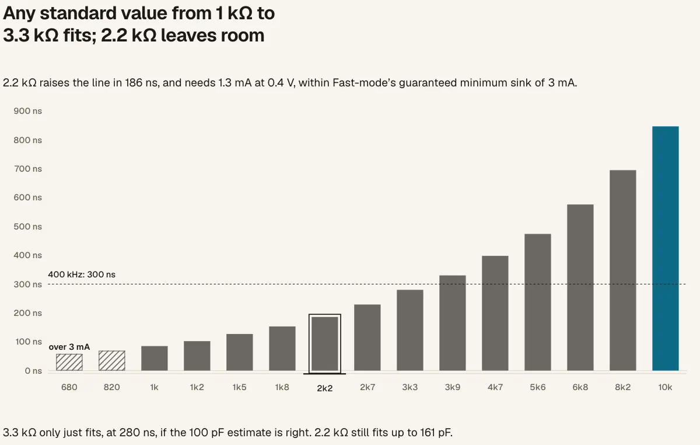
</picture>

**Text, drawing and code that point at each other.** A numbered part lights up in the prose, the diagram and the diff together.

<picture>
  <source media="(prefers-color-scheme: dark)" srcset="examples/media/echarts-compressed-linked-dark.webp">
  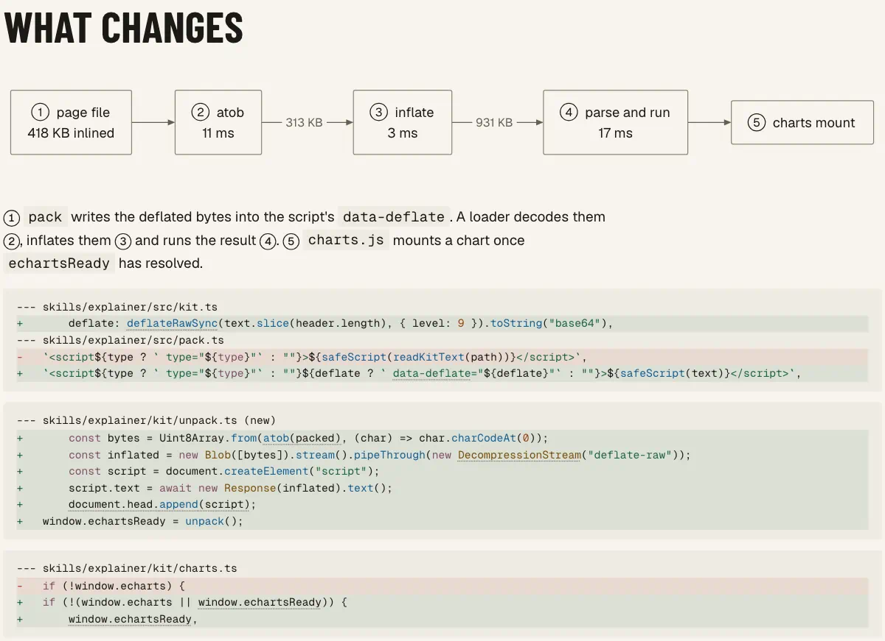
</picture>

Also on a page: drill-down views with breadcrumbs, one collection of records as a tree, sortable table or board, step-through figures, questions checked on the spot or sent back as one Markdown reply with the reader's notes, and answers that survive a reload. Light and dark, desktop and phone, and print.

## How it works

The agent reads [`SKILL.md`](skills/explainer/SKILL.md) and drives a small CLI, run as `bun <skill directory>/cli.ts`:

1. **Write** `page.mdx`: Markdown prose, the kit's components and the `.ts` or `.json` data it imports. `kit` lists what is available and `kit <name>` documents one; [`guide.md`](skills/explainer/guide.md) records what made earlier pages better or worse for their readers.
2. **Pack**: `pack page.mdx -o out.html` renders the page to static HTML, draws charts, diagrams, circuits, formulas and code colours into it, and inlines the fonts, local images and only the kit scripts the page uses, so the result is one offline file.
3. **Check**: `check out.html` opens it in headless Chrome in light and dark at 1440 and 390 px wide, scrolls it and tries its kit controls from fresh states, reports errors, network use, dead links and clipped or overflowing content, and saves screenshots for the agent to look at. `--do` runs the clicks, drags, hovers, keys and field values you name instead, and `--do reply` prints the reply the page would send.

A diagram whose parts light up from the text, for illustration:

````mdx
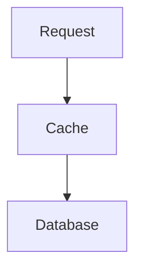

1. <span data-ref="req">A request</span> arrives.
2. <span data-ref="cache">The cache</span> misses.
3. <span data-ref="db">The database</span> answers.
````

## What a page can use

| Write | Get |
|---|---|
| `Plot` | Line, stem and bar plots as SVG with no chart library: names and values on the marks, one accent with hollow and hatch states, labelled reference markers, filled and annotated areas |
| `Chart` | ECharts in the page theme: treemap, sankey, heatmap, zoom, click-to-drill; about 0.4 MB compressed, only on pages that use it |
| `Explore`, `Controls` | A slider, choice or toggle over a plot, chart, readout or the page's own parts; `axis: true` makes a choice the plot's columns; one set of controls can drive figures in several sections |
| `Stepper` | Back, Next, a count and arrow keys over HTML, hand-built SVG or a Mermaid diagram's parts; Play and a scrubber on request |
| `View` | Drill-down views inside the one file, with Back, breadcrumbs, previous and next, and a contents rail |
| `Records` | One collection as a grouped tree, sortable table or board, with search, facets, subtotals and an answer per row |
| `Question` | Choices, the rows of a comparison table, a self-check or a written answer, with a recommendation and a note; answers join the reply |
| `Table` | A fixed comparison computed from data; a Markdown table gets the same look |
| ```` ```mermaid ```` | Flowchart, state, sequence, class, ER and xychart drawn at pack time, with number tags the text can point at |
| ```` ```schematic ```` | A circuit from a netlist: the wiring stated is the wiring drawn |
| ```` ```ts ````, ```` ```diff-ts ```` … | Code coloured at pack time, with marks that link to the prose |
| `$…$` | TeX drawn as MathML, no script |
| `data-ref` | Prose, table rows, diagram parts and marked code that share a name light up together; `.beside` keeps a figure in view while its text scrolls |
| Frontmatter | `contents: true` for a contents rail, `display: condensed` for poster headings, `reply: true` for notes, `lang` and `labels` for a page in another language |

Pages follow the system's light or dark setting. A `.tsx` component whose first line is `"use client"` covers behaviour no component does. [`skills/explainer/example/`](skills/explainer/example/page.mdx) is the page the skill ships as its example.

## Install

Both installers copy `skills/explainer/` as it is.

**npx skills** ([vercel-labs/skills](https://github.com/vercel-labs/skills))

```sh
npx skills add barisgit/explainer-skill --global --agent claude-code --agent codex -y
```

Several agents share one copy in `~/.agents/skills/explainer` and the others get symlinks; add `--copy` to give each agent its own copy. Without `--global` the skill goes into the current project. A local checkout works too: pass its path instead of `barisgit/explainer-skill`.

<details>
<summary>Install with Caplet (verified with 0.1.0)</summary>

```sh
caplet add github:barisgit/explainer-skill --pin v0.17.0 --scope user
```

Caplet needs a ref for GitHub sources. `main` follows the latest commit on each `caplet update`; pin a tag such as `v0.15.0` instead to hold a version.

Caplet copies the skill into `~/.agents/skills/explainer`, gives it to Claude Code as a plugin, and records the source in `~/.agents/capabilities.yml`. For one project, run `caplet init` in it, then `caplet add <source> --scope project`. A local checkout works too: `caplet add <path> --scope user`.

</details>

Use one installer per machine: both write `~/.agents/skills/explainer`, and Caplet does not warn when another source already emits a skill of the same name. `bun ~/.agents/skills/explainer/cli.ts kit` checks an installed copy.

**Requirements:** [Bun](https://bun.sh) (verified with 1.4.3), and Google Chrome or Chromium for `check` (`CHROME=/path/to/chrome` if it is not found; a build downloaded by agent-browser or Playwright also works). Nothing else is installed: the skill runs as copied.

<details>
<summary>Update and uninstall</summary>

```sh
npx skills update explainer --global                                     # GitHub source
npx skills add <path> --global --agent claude-code --agent codex -y      # local checkout: add again
caplet update explainer --scope user                                    # re-reads the source and applies

npx skills remove explainer --global -y
caplet remove explainer --scope user && caplet apply --scope user
```

`npx skills update` cannot check a local path, and plain `caplet apply` reuses the snapshot of a local source, so use the commands above after changing a checkout.

</details>

## Development

```sh
bun install               # dev tools and the git hook
bun run ci                # typecheck, lint (Biome), tests; what GitHub Actions runs
bun run media             # regenerates the README media from examples/ (Chrome, ffmpeg with libwebp_anim)
bun run verify:install    # before a release: installs with both installers into a temp HOME (network, Chrome)
```

`bun run media` needs all seven packed `examples/<name>/index.html` pages, Chrome or Chromium (`CHROME=/path` overrides discovery), and ffmpeg on PATH with both `libwebp` and `libwebp_anim` encoders (`ffmpeg -encoders | grep webp`). Keep the machine awake while recording. `--keep` retains the captured frames for inspection; example names limit the run, such as `bun run media --keep battery`.

Layout, decisions and limits are in [AGENTS.md](AGENTS.md). The examples are published from `examples/` by `.github/workflows/pages.yml`.

## Credits

- [visual-explainer](https://github.com/nicobailon/visual-explainer) by Nico Bailon (MIT): the look and the reply flow.
- [Apache ECharts](https://echarts.apache.org) (Apache-2.0), bundled in the kit.
- [beautiful-mermaid](https://github.com/lukilabs/beautiful-mermaid) by Craft Docs (MIT), patched, with [ELK](https://github.com/kieler/elkjs) (EPL-2.0) and [entities](https://github.com/fb55/entities) (BSD-2-Clause): the Mermaid renderer `pack` uses, not shipped in pages.
- [Preact](https://preactjs.com) and preact-render-to-string (MIT): the components and their hydration; [MDX](https://mdxjs.com) (MIT) with its unified, remark and micromark packages (MIT, one ISC), used by `pack`, not shipped in pages.
- [Temml](https://temml.org) by Ron Kok (MIT) with remark-math, micromark-extension-math and mdast-util-math (MIT): TeX to MathML in `pack`; `temml.woff2` is from the KaTeX fonts (MIT, Khan Academy).
- [TanStack Table](https://tanstack.com/table) by Tanner Linsley (MIT), with TanStack Store (MIT): the sorting, filtering, grouping and facets of `Records`.
- [refractor](https://github.com/wooorm/refractor) by Titus Wormer with [Prism](https://prismjs.com)'s grammars by Lea Verou and others (MIT), and the hast packages it uses (MIT): code fence colours in `pack`, not shipped in pages.
- [Geist and Geist Mono](https://vercel.com/font) by Vercel and [Barlow Condensed](https://github.com/jpt/barlow) by The Barlow Project Authors (SIL OFL 1.1).

Licence texts are in `skills/explainer/kit/licenses/`. The examples cite their own sources; the electricity data is from [Our World in Data](https://github.com/owid/energy-data).

## Licence

MIT, see [LICENSE](LICENSE). A copy sits in `skills/explainer/` so installed copies carry it.
