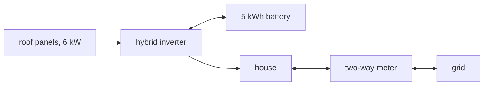

import { Explore, Question, Table } from "kit";
import Opening from "./opening.mdx";
import { euro, MONTHS, r1 } from "./energy.ts";
import { JULY, july } from "./july.ts";
import { BLOCKS, BUSIEST, LIFE, PARTS, QUOTES, SECOND_SEASONS, SIZES, TARIFF, months } from "./model.ts";

# The first 5 kWh pays for itself in *{BLOCKS[0].years} years*. The second would take {BLOCKS[1].years}.

Three quotes for a 6 kW roof on a four-person house: {QUOTES.map((q) => `${q.kwh} kWh for ${euro(q.price)}`).join(", ")}.

<Opening />

## A July night needs {r1(JULY.night)} kWh

That is what the house draws between the roof falling short in the evening and covering it again in the morning. Whatever the battery holds beyond it stays in the battery.

<Explore label="A typical July day: what the roof makes, what the house uses, and what the battery moves to the evening" controls={[{ id: "battery", label: "Battery", range: [0, 15, 1], value: 5, format: { unit: "kWh" } }]} frame={july} height="clamp(20rem, 30vw, 26rem)" />

## The second 5 kWh only works in {SECOND_SEASONS.join(" and ")}

In summer the first 5 kWh already carries the night, and in winter the roof hardly fills it. The second block takes over only on long nights after a sunny day.

<Explore label="kWh the second and third 5 kWh blocks add to what the house gets from the battery, month by month" controls={[{ id: "month", label: "Month", choice: MONTHS, value: BUSIEST, axis: true }]} frame={months} />

## The {euro(QUOTES[0].price)} is a battery, a new inverter and a new meter

<Table rows={PARTS} cols={[{ head: "Part", value: (p) => (p.tag ? <>{p.tag} {p.part}</> : p.part), note: "note" }, { head: "Price", value: "price", format: { currency: "EUR" } }]} />

## Which size?

<Question name="size" recommended="5 kWh" note rows={SIZES} cols={[{ head: "Size", value: "size" }, { head: "Price", value: "price", format: { currency: "EUR" } }, { head: "Pays back in", value: "years", format: { unit: "years" } }, { head: "Saves a year", value: "saves", format: { currency: "EUR" } }, { head: "Use not from the grid", value: "own", format: { percent: true } }]} />

Illustrative numbers, not a real quote or a measured roof. One year of invented monthly production and use, daily sun varied then normalized to keep each monthly total fixed, run quarter hour by quarter hour: surplus fills the battery and loses a tenth on the way, a shortfall empties it before the grid is asked. Electricity bought at €{TARIFF.buy.toFixed(2)} a kWh and sold at €{TARIFF.sell.toFixed(2)}; cells last {LIFE} years at one cycle a night. Left out: price changes, wear, subsidies.
