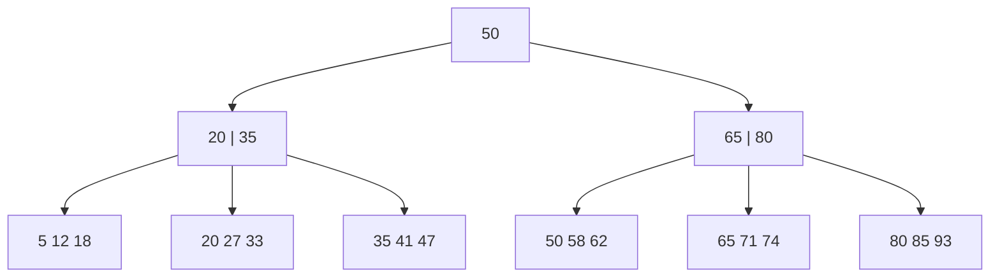

import { Stepper } from "kit";

<Stepper start={1} label="Looking up key 71, one page at a time" captions={["Read the root: 71 is at least 50, so take the right branch.", "Read the right branch: 71 is at least 65 and under 80, so take the middle leaf.", "Read the leaf and find 71. Three pages read; the other five leaves were never touched.", "A leaf holds the key and a pointer to the table row: one more read fetches the row itself."]} refs={["l_r", "l_r l_i2", "l_r l_i2 l_e", "l_e"]}>

</Stepper>
