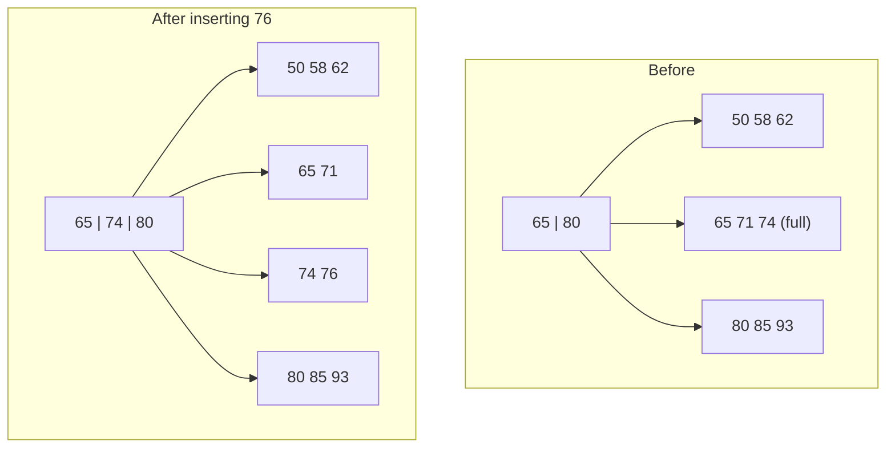
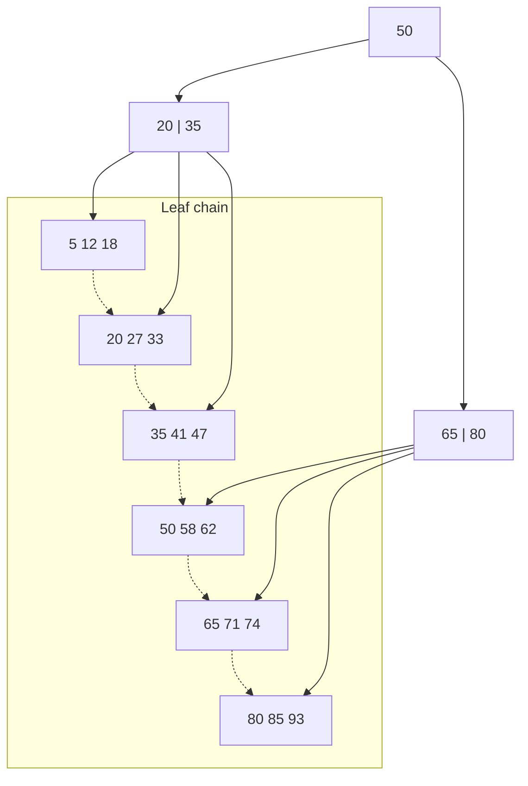

import { Explore, Question, Recall, Stepper, Term } from "kit";
import Opening from "./opening.mdx";
import { depthFrame, rangeFrame } from "./model.ts";
import "./colours.css";

# How a B-tree *index* finds a row

A lookup reads one <Term recall="page">page</Term> per level of the tree, and each page branches about 200 ways: a million rows take three reads, not a million. Step through a lookup in a small tree.

<Recall id="page">The unit a database reads and writes: usually 8 KB, holding dozens to hundreds of rows or index entries. Reading pages, from disk or from memory, is the cost that counts.</Recall>

<Opening />

## Why a million rows take three reads

Each level splits the keys into about 200 ranges, so every page you read throws away 199 of 200 candidates. Pick the table size and how many entries fit on a page.

<Explore label="Pages on each level of the tree" controls={[{ id: "rows", label: "Rows, as a power of ten", range: [3, 9, 1], value: 6 }, { id: "fan", label: "Entries per page", choice: ["50", "200", "500"], value: "200" }]} frame={depthFrame} />

<Question name="billion" legend="With 200 entries per page, how many pages does a lookup read in a table of a billion rows?" options={["3", "4", "5"]} answer="4">

Three levels reach $200^3 = 8$ million leaf entries. A billion needs a fourth: $200^4 = 1.6$ billion.

</Question>

Two things keep the real cost lower still. The root and branch pages are few and hot, so they sit in memory and a lookup usually costs one disk read, for the leaf. And a tree stays this shallow only because it stays balanced, which is what the split below guarantees.

B-tree or B+ tree?

Databases mostly use the B+ tree variant: keys are copied up as signposts, but all entries live in the leaves, and the leaves are chained. That chain is what makes the range scan below cheap. PostgreSQL, MySQL's InnoDB and SQLite all work this way, with 8 KB, 16 KB and 4 KB pages respectively by default.

## What happens when a page fills up

An insert goes to the leaf where its key belongs. Only when that leaf is full does the tree change shape, and then only locally.

1. Insert 76. The descent lands on the leaf that holds 65, 71 and 74, which is full.
2. The database allocates a new page and moves the upper half of the keys to it, then adds 76: 65 71 and 74 76.
3. The new leaf needs a signpost. Its lowest key, 74, is copied into the parent, which gains one key.
4. Nothing else moves: the other leaves, the root and every other lookup path are unchanged.

<figure>

</figure>

If the parent was full too, it splits the same way and pushes a key into its own parent. Only when the root splits does the tree grow a level, from the top, so every leaf stays at the same depth. That is why lookup cost never degrades with insert order.

The price is paid in writes: a split touches three pages (two leaves and the parent), and each half is left about half full, so a table loaded in random key order carries more index pages than one loaded in key order.

## Why a range scan is cheap

`WHERE k BETWEEN 33 AND 58` descends once, to the first match, then walks sideways along the leaf chain. Rows come out already sorted, and the scan ends at the first key past the range.

<Stepper start={1} label="Scanning keys 33 to 58" captions={["Descend to the leaf holding 33: root, branch, leaf, three reads.", "Follow the sibling link to the next leaf: 35, 41, 47 all match.", "One more link: 50 and 58 match, and 62 is past the range, so the scan stops. Five pages for six rows."]} refs={["r_r r_i1 r_b", "r_c", "r_d"]}>

</Stepper>

Each extra page of the range costs one read and yields about 200 rows, so the cost is the descent plus a page per 200 matches. Drag the range up and compare:

<Explore label="Pages read for a range, in a table of a million rows" controls={[{ id: "match", label: "Rows matching", range: [1, 20000, 1], value: 200, format: { digits: 0 } }]} frame={rangeFrame} />

The middle bar is the trap. When the index holds only the key, every match needs its own trip to the table, usually to a different page. Past a few thousand matches that costs more than reading the table front to back, and the planner switches to a sequential scan, which is the `Seq Scan` that surprises people when a query is not selective.

<b>Basis</b>The sizes are illustrative: 8 KB pages holding about 200 entries (roughly 40 bytes each), and a table of one million rows at 200 rows a page. Real fan-out depends on key width, fill factor and the engine.

