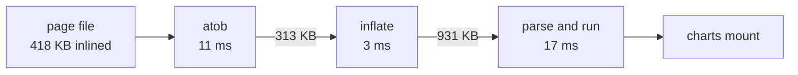

import { Question, Table } from "kit";
import data from "./data.json";
import { encodings } from "./rows.ts";
import Opening from "./opening.mdx";
import "./colours.css";

# Shipping ECharts *compressed*

Compressing ECharts takes {data.saved} KB off every chart page and costs {Object.values(data.unpackMs).reduce((sum, ms) => sum + ms, 0)} ms on load. Commit 7d4f018 makes pack inline `kit/echarts.js` as deflate-raw and the page unpack it on load.

<Opening />

## What changes



<span data-ref="file">1</span> `pack` writes the deflated bytes into the script's `data-deflate`. A loader decodes them <span data-ref="atob">2</span>, inflates them <span data-ref="inflate">3</span> and runs the result <span data-ref="run">4</span>. <span data-ref="mount">5</span> `charts.js` mounts a chart once `echartsReady` has resolved.

```diff-ts ref:file="deflateRawSync" ref:file='data-deflate'
--- skills/explainer/src/kit.ts
+		deflate: deflateRawSync(text.slice(header.length), { level: 9 }).toString("base64"),
--- skills/explainer/src/pack.ts
-	`<script${type ? ` type="${type}"` : ""}>${safeScript(readKitText(path))}</script>`,
+	`<script${type ? ` type="${type}"` : ""}${deflate ? ` data-deflate="${deflate}"` : ""}>${safeScript(text)}</script>`,
```

```diff-ts ref:atob="atob(packed)" ref:inflate="DecompressionStream" ref:run="document.head.append(script)"
--- skills/explainer/kit/unpack.ts (new)
+		const bytes = Uint8Array.from(atob(packed), (char) => char.charCodeAt(0));
+		const inflated = new Blob([bytes]).stream().pipeThrough(new DecompressionStream("deflate-raw"));
+		const script = document.createElement("script");
+		script.text = await new Response(inflated).text();
+		document.head.append(script);
+	window.echartsReady = unpack();
```

```diff-ts ref:mount="window.echartsReady"
--- skills/explainer/kit/charts.ts
-	if (!window.echarts) {
+	if (!(window.echarts || window.echartsReady)) {
+		window.echartsReady,
```

## Alternatives

<Table rows={encodings} state={(e) => e.state} cols={[{ head: "Encoding", value: "name", note: "why" }, { head: "In the page", value: "size", format: { unit: "KB" } }, { head: "Baseline browsers decode it", value: (e) => (e.decodes ? <span class="mark yes">Yes</span> : <span class="mark no">No</span>) }]} />

The island bundle (60 to 300 KB) stays plain: it must run before the views and steps scripts, and unpacking it would delay them. CSS stays plain because it cannot wait for a script.

## Older browsers

The `deflate-raw` format needs Chrome 103, Firefox 113 or Safari 16.4. On older browsers the unpack fails and logs the failure. The charts pack drew stay; the live ones that replace them never mount.

<section class="band">

## Approve shipping ECharts compressed?

<Question name="verdict" recommended="approve" note options={{ approve: "Approve", changes: "Request changes", ask: "Ask a question" }} />

</section>

<section class="minor">

## Basis

Sizes are measured from `kit/echarts.js` by `measure.ts`; the timings are the ones the repository's AGENTS.md records.

</section>
