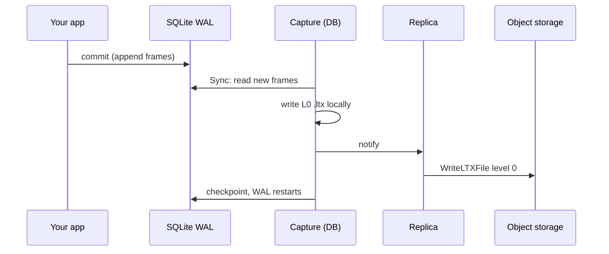
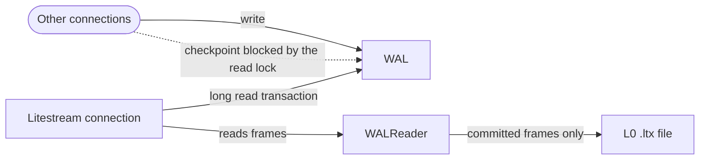
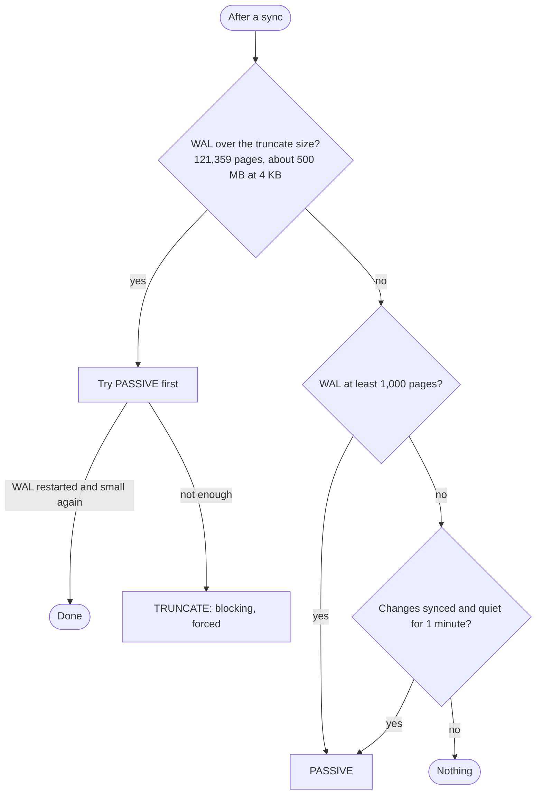
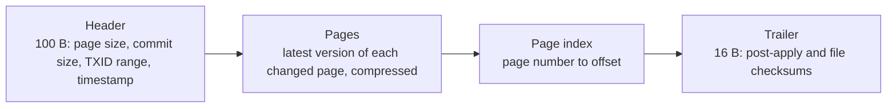
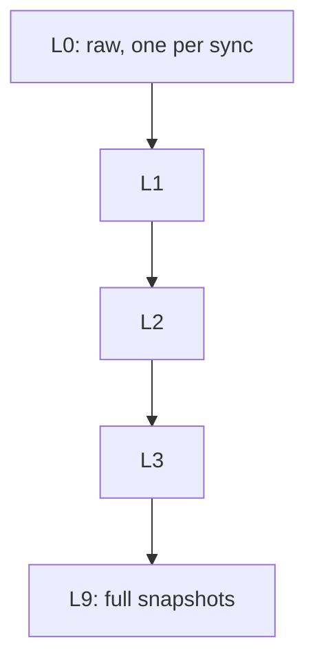
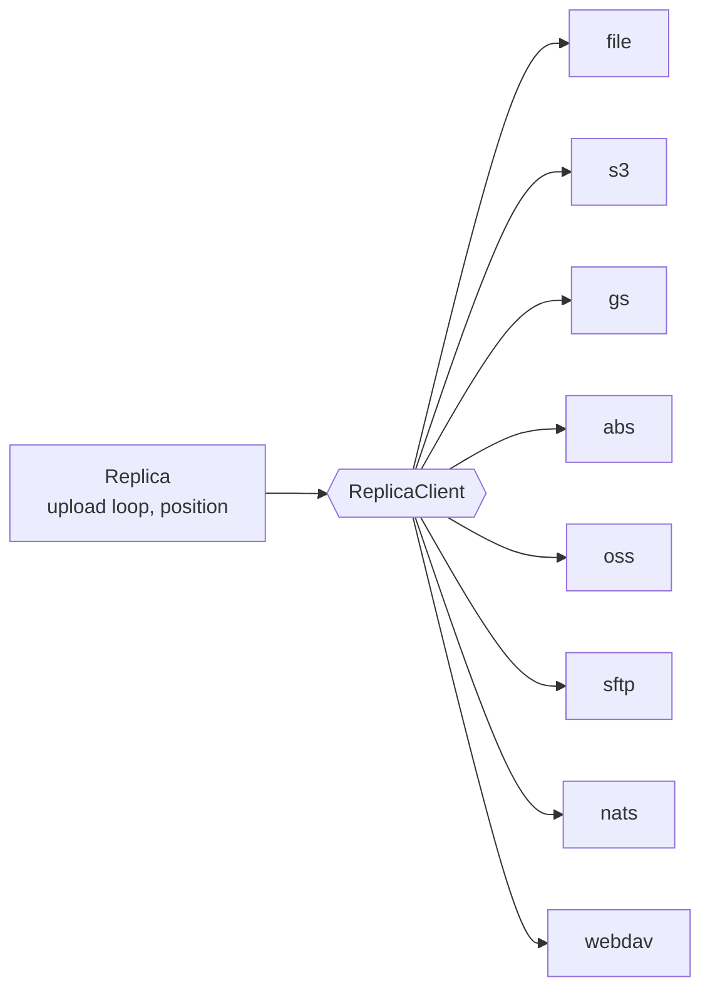
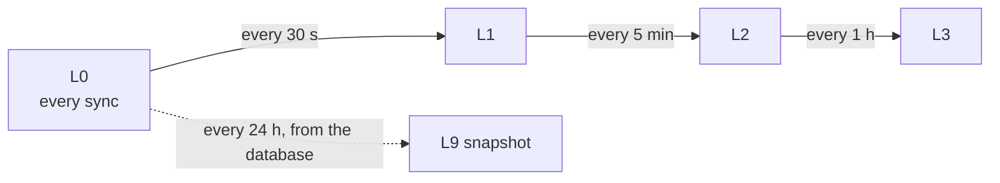
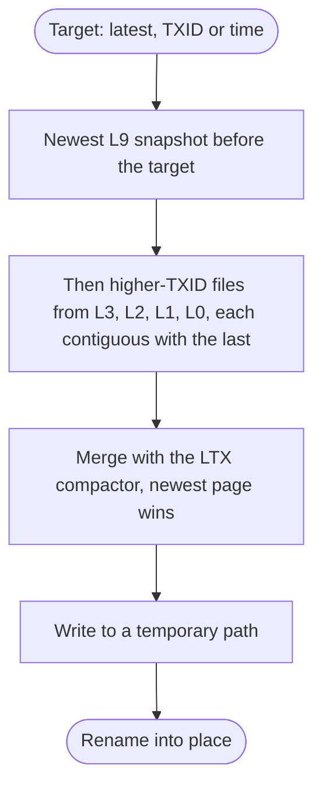
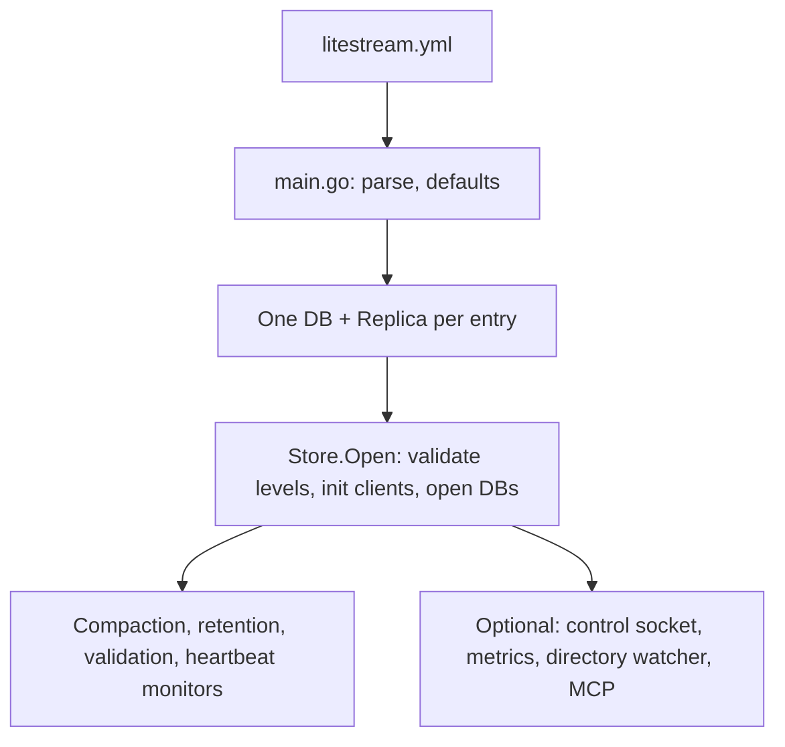
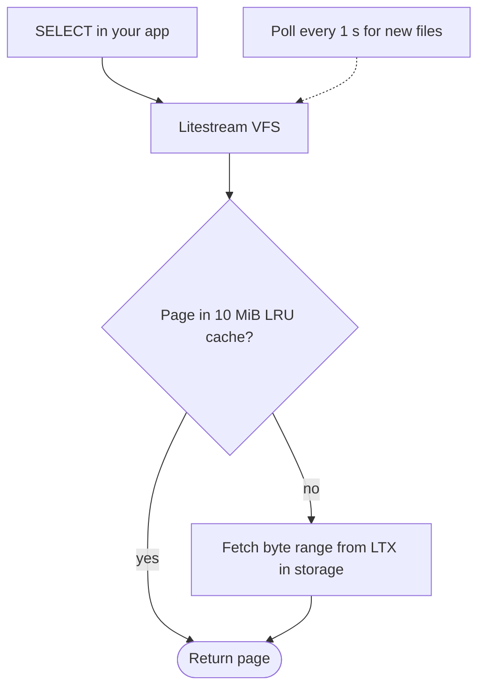

import { Plot, Stepper, View } from "kit";
import Opening from "./opening.mdx";
import "./colours.css";

# How *Litestream* works

Litestream is a background Go process that watches a SQLite database's write-ahead log and ships every committed change to object storage, so a lost disk costs seconds of data. It never sits in your app's read or write path.

## The whole system

{/* List first, map second: each item and its node share a data-ref; the name opens that part's view. The map is opening.mdx, which the gallery shows too. */}

- 1 [Capture](#part/capture): WAL frames to local files.
- 2 [LTX files](#part/ltx): the immutable file format.
- 3 [Replicate](#part/replicate): upload to eight backends.
- 4 [Compact](#part/compact): merge and prune by time level.
- 5 [Restore](#part/restore): replay files into a database.
- 6 [CLI and control](#part/control): config, commands, socket.
- 7 [VFS](#part/vfs): query the replica without restoring.

<Opening />

## One commit

{/* Walkthrough of a single write, end to end, with the real defaults. */}

<Stepper start={1} label="One commit, from your app to the bucket" refs={["m1", "m2", "m3", "m4", "m5", "m6"]} captions={["Your app commits a transaction. SQLite appends frames to the WAL; Litestream holds a long read transaction so no one else's checkpoint can erase frames it has not copied yet.", "The monitor wakes (every 1 s by default) and calls Sync. It reads the new frames, up to the last commit marker.", "Capture writes them as an L0 file named `<minTXID>-<maxTXID>.ltx` in a local metadata directory, and wakes the replica.", "The replica monitor picks the file up (also 1 s pacing) and sends it to the storage client.", "The client stores it as `ltx/0/…` on a file replica, or `0000/…` on S3.", "Later, a checkpoint folds the WAL into the main file. Litestream copies what it still needs first, then lets the WAL restart."]}>

</Stepper>

## Size of each part

<Plot label="Non-test Go lines per part" option={{ categories: ["Backends (8)", "CLI and control", "VFS", "Capture", "Replicate", "Store and compact"], horizontal: true, series: [{ name: "Lines", type: "bar", data: [5582, 6140 + 683, 3886, 3927, 2856, 1633], fill: ["", "", "", "accent", "", ""], label: true }] }} />

Capture is the densest logic. The CLI is large because of configuration, not replication.

## Layers

| Layer | Owns | File |
|---|---|---|
| CLI | Config, wiring, signals | [`cmd/litestream`](https://github.com/benbjohnson/litestream/tree/main/cmd/litestream) |
| Store | Many databases, maintenance timers | `store.go` |
| DB | One SQLite file: WAL, checkpoints | `db.go` |
| Replica | One destination for that DB | `replica.go` |
| ReplicaClient | Raw storage verbs | `replica_client.go` |

Line counts are from the cloned tree at commit 3e0fdc0. Design claims follow the repo's [architecture notes](https://github.com/benbjohnson/litestream/blob/main/docs/ARCHITECTURE.md), checked against the code.

<View name="part" param="capture" back="Litestream">

# Capture: from WAL to local files

One `DB` per database file. It is where nearly all the hard SQLite knowledge lives.

## What it keeps hold of

SQLite only folds the WAL back into the main file when no reader needs those frames. Litestream's standing read transaction makes it that reader, so outside checkpoints cannot discard unseen data. Other connections keep writing meanwhile.

Litestream also creates a `_litestream_lock` table in your database to take SQLite's write lock around checkpoints. It is expected and rolled back, never holds rows.

## When it checkpoints

`checkpointIfNeeded` tries these in order.

PASSIVE never blocks writers and is skipped quietly on a busy database. TRUNCATE is the emergency exit that stops a stuck reader from growing the WAL without bound.

What can go wrong reading a WAL?

Frames carry salts and a running checksum, and only those ending at a commit marker count. The WAL can restart without changing length, so size polling alone misses it; `verify` and `detectFullCheckpoint` compare salts and the last matching page. SQLite's reserved lock page is skipped.

</View>

<View name="part" param="ltx" back="Litestream">

# LTX: the one file format

Every transfer, merge and restore uses [LTX](https://github.com/superfly/ltx), a library Litestream imports. A file is an immutable range of transactions.

## Anatomy and name

The name is the range it covers: `0000000000000003-0000000000000007.ltx` holds transactions 3 to 7. A file with min TXID 1 is a full snapshot; anything else needs its predecessors.

## Where files go

| Backend | Path for level 1 |
|---|---|
| File | `<root>/ltx/1/<name>.ltx` |
| S3 | `<prefix>/0001/<name>.ltx` |

Neither keeps a manifest. A restore lists a level and each file carries its own index.

</View>

<View name="part" param="replicate" back="Litestream">

# Replicate: one interface, eight backends

`Replica` tracks how far storage has got and uploads; it knows nothing about S3.

## The seam

Each backend implements: `Init`, `LTXFiles` (list a level in TXID order), `OpenLTXFile` (byte range), `WriteLTXFile`, `DeleteLTXFiles`, `DeleteAll`. A missing file must match `os.ErrNotExist`, and the LTX header timestamp must survive upload.

<Plot label="Non-test Go lines per backend" option={{ categories: ["s3", "oss", "nats", "abs", "sftp", "webdav", "file", "gs"], horizontal: true, series: [{ name: "Lines", type: "bar", data: [2270, 726, 520, 499, 462, 412, 378, 315], fill: ["accent", "", "", "", "", "", "", ""], label: true }] }} />

S3 is the reference: multipart uploads, pagination, and the lease code in `s3/leaser.go`.

## Position and resume

`Replica.Pos` is the TXID and checksum it last uploaded. At startup Capture compares local and remote positions; if storage is ahead, local metadata is refreshed. Streams use a `ResumableReader`: after a dropped connection it reopens at the current byte offset.

Failures back off exponentially, up to 5 minutes between retries, with rate-limited logging.

</View>

<View name="part" param="compact" back="Litestream">

# Compact: many small files into few big ones

Left alone, one file per second would pile up. `Store` runs timers that merge them.

## The ladder

<Plot label="Files written per day at each level (30 s, 5 min, 1 h, 24 h, derived from the default intervals)" option={{ categories: ["L1", "L2", "L3", "L9"], series: [{ name: "Files per day", type: "bar", data: [2880, 288, 24, 1], fill: ["", "", "", "accent"], label: true }] }} />

The Store checks whether a level is due and has new data, then compacts it. A merge keeps the latest version of each page and takes its timestamp from the newest input, so time-based restore stays accurate. It prefers local input and falls back to a resumable remote read.

## What gets deleted

- L0 files go after L1 compaction, on their own hourly check.
- Snapshots go past a 24 hour cutoff.
- Middle levels go older than the oldest retained snapshot.

A `Store` can also validate that levels have no TXID gaps, and ping a heartbeat URL (5 minutes by default). With retention disabled, deletion is left to your bucket's lifecycle rules.

</View>

<View name="part" param="restore" back="Litestream">

# Restore: replay a chain

Restore targets the latest point, a TXID, or a timestamp (not both).

## Planning

Files stream through resumable readers, fetched with 8-way parallelism by default. The plan is checked for contiguity, and a gap is an error instead of a silent hole.

## Variants

- **Follow mode** keeps applying new files every second and records the last applied TXID in a sidecar file.
- **Legacy v0.3.x backups** on S3 and file replicas restore through a separate path (`v3.go`).
- **`EnsureExists`** restores a missing database before replication starts, if a backup exists.

</View>

<View name="part" param="control" back="Litestream">

# CLI and control: running it

`litestream replicate` reads a YAML config, builds the objects above, opens the Store and waits for a signal.

## Startup and commands

| Command | Does |
|---|---|
| `replicate` | Run the daemon |
| `restore` | Rebuild a database |
| `ltx`, `databases`, `list`, `info` | Inspect files and state |
| `register`, `unregister`, `start`, `stop`, `sync`, `status` | Change a running daemon over the socket |
| `reset`, `version` | Local maintenance |

## Extras

The control socket (off by default, `/var/run/litestream.sock`, mode `0600`) exposes `/register`, `/sync`, `/txid`, `/list` and debug routes. A directory watcher adopts databases that appear under a path. Prometheus metrics come from `addr`. Shutdown is bounded by `shutdown-timeout` (30 s default); a second signal quits at once.

</View>

<View name="part" param="vfs" back="Litestream">

# VFS: read straight from the replica

A SQLite extension, [`litestream-vfs`](https://github.com/benbjohnson/litestream/blob/main/docs/VFS.md), so a reader needs no restore.

## How a read works

Load it with `.load litestream-vfs.so` and open `file:db?vfs=litestream`. It can also hydrate a local copy in the background and query older states by timestamp. Write mode exists but is documented as experimental.

Building needs CGO and a `vfs` build tag, which is why it lives apart from the daemon.

</View>
