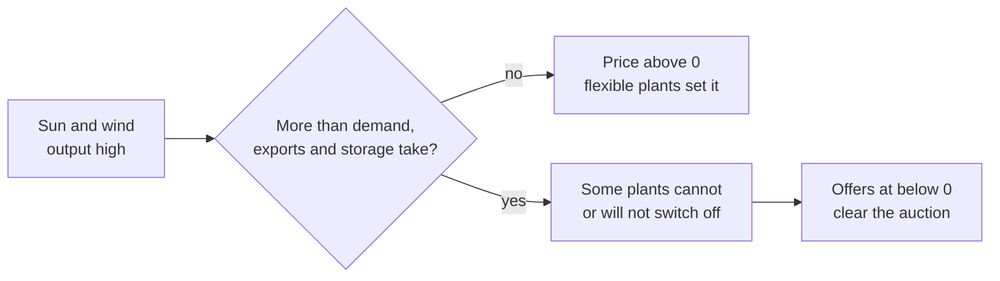

import { Chart, Controls, Explore, Plot } from "kit";
import Opening from "./opening.mdx";
import { dayLabels, priceFrame, supplyFrame, heat, months, hourNames, rlBins, depth, depthNames, depthTotal, wd, cls, avg, low } from "./model.ts";

import "./colours.css";

# Why German electricity prices go *negative*

When sun and wind produce more than Germany can use, export or store, the day-ahead price drops below zero: 576 hours in 2025 (6.6% of the year), up from 211 in 2019. Hour by hour, it happens mostly around midday on spring and summer Sundays.

<Opening />

## What the price does

The day-ahead price is set by an auction: sellers offer power at a minimum price, buyers bid, and the last offer needed to cover demand sets the price for everyone. It goes below zero when sellers are willing to pay to deliver.

Some plants lose less by paying than by stopping: subsidised wind and solar whose revenue does not depend on the hourly price, combined heat-and-power plants that must deliver heat, and large thermal units that are costly to restart. This is the usual explanation, not something the price data itself shows.

<b>Inferred</b>The data below shows when prices go negative and which conditions come with it; the motives of individual sellers are not in it.

## How far below zero

Most negative hours are shallow: of the {depthTotal.toLocaleString("en")} negative hours since 2019, about 60% sit within 5 EUR/MWh of zero. Deep spikes are rare: the lowest hour, −500 EUR/MWh on 2 July 2023, is the day-ahead auction's harmonised minimum clearing price in force then ([ACER Decision 01/2023](https://www.acer.europa.eu/sites/default/files/documents/Individual%20Decisions/ACER%20Decision%2001-2023%20on%20HMMCP%20SDAC.pdf), recital 82).

<Plot label="Negative hours since 2019 by price range" height="18rem" option={{ categories: depthNames, series: [{ name: "Hours", type: "bar", data: depth.map((d) => d.n), label: true }], y: { name: "hours" } }} />

## What drives it: supply left after demand

Subtract wind and solar from demand and what remains is the load other plants must serve (Energy-Charts calls it residual load). Below about 7 GW, more than half of all hours are negative; above 20 GW almost none.

<Plot label="Share of hours with a negative price by residual load, Germany 2023 to 2025" height="20rem" option={{ categories: rlBins.map((b) => `${b.lo} to ${b.hi}`), series: [{ name: "Share negative", type: "bar", data: rlBins.map((b) => b.share), fill: rlBins.map((b) => (b.share !== null && b.share >= 50 ? "accent" : "")), label: { digits: 0, unit: "%" } }], y: { name: "% of hours negative", min: 0, max: 100 }, x: { name: "residual load, GW" } }} />

Residual load falls when demand is low or when wind and solar are high. Negative hours differ from the rest in both, solar most of all:

| Average, 2023 to 2025 | Negative hours | Other hours |
|---|---:|---:|
| Solar, GW | {avg.s[0]} | {avg.s[1]} |
| Wind, GW | {avg.w[0]} | {avg.w[1]} |
| Demand, GW | {avg.l[0]} | {avg.l[1]} |
| Residual load, GW | {avg.rl[0]} | {avg.rl[1]} |

Of the 1,334 negative hours in 2023 to 2025, {cls.solar} had more solar than wind with wind under 8 GW, {cls.wind} the reverse, and {cls["solar+wind"]} both above 8 GW. Most negative hours have both; wind alone produces them too, as in winter.

More solar capacity moves the curve left: the year's peak solar output rose from {low["2023"].solarMax} GW in 2023 to {low["2025"].solarMax} GW in 2025, and hours with residual load under 5 GW from {low["2023"].low} to {low["2025"].low}.

## When it happens

Solar sets the daily rhythm and the season: negative prices cluster from March to September around noon. Share of hours with a negative price, by month and hour of day, 2023 to 2025. The peak is the hour from 14:00 in May: 46% negative.

<Chart label="Share of hours with a negative price by month and hour of day, Germany 2023 to 2025" height="22rem" option={{ grid: { top: 8, left: 40, right: 8, bottom: 56 }, xAxis: { type: "category", data: hourNames, name: "hour of day (local time)", nameLocation: "middle", nameGap: 28, splitArea: { show: false } }, yAxis: { type: "category", data: months, inverse: true }, visualMap: { min: 0, max: 50, calculable: false, orient: "horizontal", left: "center", bottom: 0, itemWidth: 12, itemHeight: 160, text: ["50%", "0%"], inRange: { color: ["var(--sunken)", "var(--accent)"] } }, series: [{ type: "heatmap", data: heat, itemStyle: { borderColor: "var(--under)", borderWidth: 1 }, label: { show: false }, emphasis: { disabled: true } }], tooltip: { formatter: "{c}" } }} />

The weekday matters as much as the hour. On April to September days between 11:00 and 14:59, demand drops at the weekend while solar stays the same:

<Plot label="Share of April to September midday hours with a negative price by day of week, 2023 to 2025" height="16rem" option={{ categories: wd.map((d) => d.name), series: [{ name: "Share negative", type: "bar", data: wd.map((d) => d.share), fill: ["", "", "accent"], label: { digits: 0, unit: "%" } }], y: { min: 0, max: 100, name: "% of hours negative" } }} />

## Four days

Pick a day to see price against demand, solar and wind. On Sunday 11 May 2025 solar alone (42 GW) exceeds demand (40 GW) at 13:00 and the price falls to −250; an ordinary January weekday stays above 0 all day.

<Controls id="day" controls={[{ id: "day", label: "Day", choice: dayLabels }]} />

<Explore use="day" label="Hourly day-ahead price on the chosen day" frame={priceFrame} height="14rem" />

<Explore use="day" label="Hourly demand, solar and wind on the chosen day" frame={supplyFrame} height="16rem" />

The holiday behaves like a Sunday. Christmas Eve 2023 shows the wind mechanism: little demand and strong wind keep the price just below zero for most of the day, never deeper than −9.

<section class="minor">

## Data and method

Prices: day-ahead auction, bidding zone Germany–Luxembourg (DE-LU), hourly, EUR/MWh, 2019 to 2025. Generation and demand: public net generation and load for Germany, 15-minute values, 2023 to 2025. Both from [Energy-Charts](https://energy-charts.info) (Fraunhofer ISE), which publishes the price data from the Bundesnetzagentur (SMARD.de, CC BY 4.0) and generation data from ENTSO-E and others; downloaded from [api.energy-charts.info](https://api.energy-charts.info/) on 27 November 2026 (`fetch.ts` repeats the download and writes `data.json`). Licence: CC BY 4.0. Hours are local time; 15-minute values are averaged per hour, which includes the day-ahead price from 1 October 2025, when the auction moved to 15-minute products. Negative means below 0 EUR/MWh on that hourly mean. Drivers and patterns use 2023 to 2025, 26,304 hours; the analysis is the page's own, from these files.

</section>
