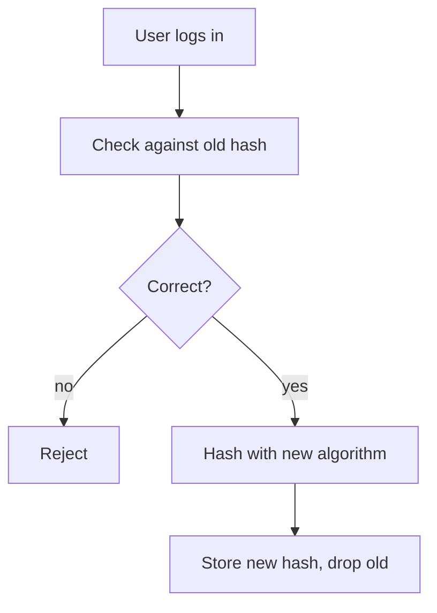
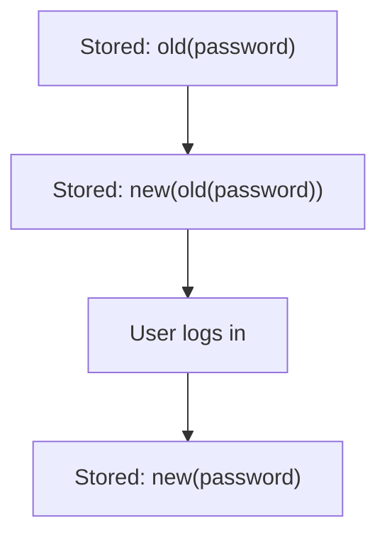
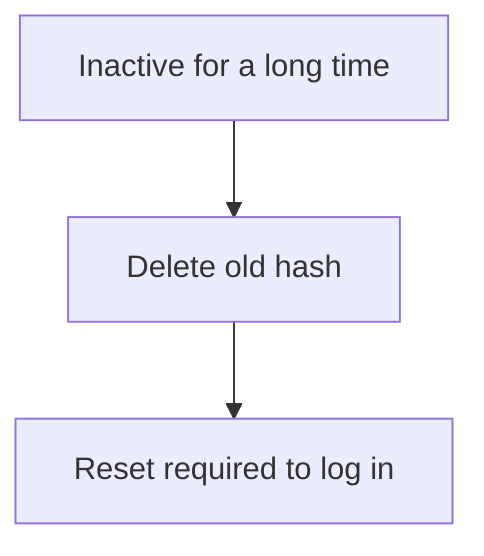

import { Chart, Question, Table, View } from "kit";
import { AlgoStats } from "./algorithms.tsx";
import { Budget } from "./budget.tsx";
import { ALGO_ROWS, ALGOS, iterationsChart, settingsChart } from "./owasp.ts";
import "./page.css";

export const SETTING_COLS = [
	{ head: "Setting", value: "setting" },
	{ head: "Nominal memory", value: "memory" },
	{ head: "Trade-off", value: "tradeOff" },
];

# Use *Argon2id*, unless a FIPS-140 requirement makes it *PBKDF2*. Memory per login decides the rest.

OWASP ranks the four: Argon2id first, scrypt when Argon2id is unavailable, PBKDF2 when FIPS-140 is required, bcrypt only for legacy systems. Set your deployment below and see which OWASP setting fits.

<Budget />

## What OWASP says about each algorithm

<Table
	rows={ALGO_ROWS}
	state={(a) => a.state}
	cols={[
		{ head: "Algorithm", value: "name", link: (a) => `#algo/${a.id}` },
		{ head: "OWASP's role", value: "role" },
		{ head: "Minimum setting", value: "minimum" },
		{ head: "Nominal memory", value: "memory" },
		{ head: "FIPS-140 validated", value: "fips" },
		{ head: "Watch out for", value: "watch" },
	]}
/>

Rules that apply whichever you pick

- **Salt:** a unique random salt per password. Most libraries generate and store it for you.
- **Pepper:** an optional secret shared by all passwords and stored outside the database (secrets vault or HSM). OWASP says it adds defence in depth but not security on its own. Changing a pepper forces every affected user to reset their password.
- **Work factor:** a hash should generally take under one second. Too high lets an attacker exhaust your CPU with login attempts. Benchmark on the servers you will actually run.
- **Unicode:** accept every code point, including NUL bytes, and do not reduce the entropy of what the user typed before hashing.
- **Fast hashes** such as plain SHA-256 are not suitable for password storage.

{/* The radios switch the panels through page.css alone; each panel's data-ref terms light the diagram node with that Mermaid id. */}

<section id="migration">

## Three ways OWASP describes to move old hashes forward

Whatever you migrate to, store the algorithm and cost next to each hash, for example in the PHC string format, so old and new hashes can coexist during the transition.

<label><input type="radio" name="mig" value="login" checked />Re-hash at login</label>
<label><input type="radio" name="mig" value="wrap" />Wrap the stored hash</label>
<label><input type="radio" name="mig" value="expire" />Expire inactive users</label>

The user's old-hash check is the only moment you hold the plaintext password, so that is when the new hash gets made. Users who never return keep their old hash until you act on them.

1. The user enters their password.
2. Your code reads the stored hash and its algorithm tag, and checks the password with the old algorithm, the only judge of whether it is right.
3. A wrong password is rejected; nothing is stored.
4. A correct one is hashed again with the new algorithm and cost.
5. The new hash replaces the old one. This user no longer has a weak hash at rest.

<figure class="fig" aria-label="Re-hash at login">

</figure>

OWASP's second method feeds the existing hash into the new algorithm, so you can protect every row now without knowing any password. It also notes that layering can make hashes easier to crack, so the direct hash should replace it at the next login.

1. Every row holds a hash made by the legacy algorithm, such as `md5(password)`.
2. A batch job hashes each stored hash with the new algorithm. No password is needed. Layering has algorithm- and encoding-specific risks, so it is a stopgap.
3. At the next login, check the password through both layers.
4. Then hash the plain password directly with the new algorithm and drop the layered form.

<figure class="fig" aria-label="Wrap the stored hash">

</figure>

The expire-and-delete method removes old hashes of long-inactive users and makes them reset their password. It is safe, but OWASP warns it is unfriendly: it can swamp support, and users may read it as a sign of a breach.

1. Some users never log in, so the re-hash at login never reaches them.
2. After an inactivity period you choose (OWASP gives none), their old hashes are deleted from the database.
3. Their next login needs a password reset, which creates a hash with the new algorithm.

<figure class="fig" aria-label="Expire inactive users">

</figure>

OWASP calls bcrypt at cost 10 or more acceptable for legacy systems, so those hashes can wait for the re-hash at login.

</section>

{/* The one band: the decision the page ends in, asked on the page. data-state="maybe" marks all three as open; a Markdown table cannot carry it. */}

<section class="band" id="decision">

## How many hashing algorithms will you run?

The constraints leave one real decision: whether the FIPS-140 requirement applies to everyone or only to some deployments.

<table class="compare">
<thead><tr><th>Option</th><th>What it means</th><th>Cost</th></tr></thead>
<tbody>
<tr data-state="maybe"><th scope="row">A. Argon2id everywhere</th><td data-label="What it means">One code path, OWASP's first choice, at least 7 MiB per simultaneous login.</td><td data-label="Cost">Rules out customers who require FIPS-140 validated cryptography, unless your validated module also covers Argon2id (the cheat sheet does not say).</td></tr>
<tr data-state="maybe"><th scope="row">B. PBKDF2-HMAC-SHA256 everywhere</th><td data-label="What it means">One code path that can serve FIPS-140 customers, provided PBKDF2 runs in a validated module in its approved configuration. No memory-cost parameter.</td><td data-label="Cost">Gives up memory-hard hashing for everyone. OWASP recommends it only when FIPS-140 is required.</td></tr>
<tr data-state="maybe"><th scope="row">C. Argon2id by default, PBKDF2 where FIPS-140 is required</th><td data-label="What it means">Best algorithm where allowed; each record carries its algorithm and cost.</td><td data-label="Cost">Two code paths and two test matrices to maintain.</td></tr>
</tbody>
</table>

<b>Inferred</b>OWASP does not rank these three options; they come from combining its rules. Our reading: if no customer requires FIPS-140, choose A. If only some do, C usually costs less security than B. If all do, choose B. Whichever you pick, set the memory budget from a measurement on your smallest VM, not from this page's sliders.

<Question name="option" legend="Which option will you take?" options={{ A: "A. Argon2id everywhere", B: "B. PBKDF2 everywhere", C: "C. Argon2id plus PBKDF2 for FIPS", Undecided: "Not yet" }} />

{/* A checklist of long items reads better as toggles, one per line, than as Question's segmented buttons. */}

<fieldset data-reply>
<legend>What do you still need to find out?</legend>

<label class="toggle"><input type="checkbox" id="q-fips" name="todo" value="fips" />Which customers require FIPS-140 validation, and for which part of the system</label>

<label class="toggle"><input type="checkbox" id="q-mem" name="todo" value="mem" />Measured memory and time per login on the smallest VM</label>

<label class="toggle"><input type="checkbox" id="q-legacy" name="todo" value="legacy" />Which legacy hash types are in the database</label>

<label class="toggle"><input type="checkbox" id="q-lib" name="todo" value="lib" />Whether our language has a maintained Argon2id library</label>

</fieldset>

</section>

<section class="sources minor">

## Sources

- [OWASP Cheat Sheet Series, Password Storage Cheat Sheet](https://cheatsheetseries.owasp.org/cheatsheets/Password_Storage_Cheat_Sheet.html), fetched 22 Oct 2026; latest change to the file on that date was commit 3c07d4a of 4 Oct 2026. Every setting, role and warning on this page comes from it; how the algorithms work, such as which are memory-hard, is standard background, and where the page reasons past the cheat sheet it says so beside the claim. Licence: [CC BY-SA 4.0](https://creativecommons.org/licenses/by-sa/4.0/). Settings are reproduced and rearranged here; this page is offered under the same licence.
- The cheat sheet itself cites [NIST SP 800-63B-4](https://pages.nist.gov/800-63-4/sp800-63b.html#passwordver) (PBKDF2 permitted), [RFC 9106](https://www.rfc-editor.org/rfc/rfc9106.html) (Argon2) and [RFC 7914](https://www.rfc-editor.org/rfc/rfc7914.html) (scrypt).

</section>

{/* One view per algorithm at #algo/<id>; the comparison table and the chart's bars link to them. */}

<View name="algo" param="argon2id" back="All algorithms">

# Argon2id

Winner of the 2015 Password Hashing Competition. The Argon2id variant balances resistance to side-channel and GPU-based attacks.

<AlgoStats algo="argon2id" />

<figure class="fig">
<Chart height="clamp(14rem, 36vw, 18rem)" label="OWASP's Argon2id settings: memory against passes" option={settingsChart("argon2id")} />
<figcaption>Vertical axis: passes (t). Horizontal axis: nominal memory in MiB. OWASP's settings trade memory against passes.</figcaption>
</figure>

## Every OWASP setting

<Table rows={ALGOS.argon2id.settings} cols={SETTING_COLS} />

## Notes from OWASP

- Three cost parameters: memory m in KiB, passes t, and parallelism p (lanes the memory is divided over). Raising p does not multiply memory or act as a pass count.
- All five settings give an equal level of defence. The only difference is the trade between CPU and RAM.
- The first two lines (46 MiB with t=1, 19 MiB with t=2) must not be used with Argon2i.
- Tune memory and passes to make cracking expensive while keeping login practical under expected load, and benchmark on the target system. More parallelism is not guaranteed to slow guessing.

[Read this section in the cheat sheet](https://cheatsheetseries.owasp.org/cheatsheets/Password_Storage_Cheat_Sheet.html#argon2id)

</View>

<View name="algo" param="scrypt" back="All algorithms">

# scrypt

A password-based key derivation function by Colin Percival. OWASP calls Argon2id the best choice and scrypt the one to use when Argon2id is not available.

<AlgoStats algo="scrypt" />

<figure class="fig">
<Chart height="clamp(14rem, 36vw, 18rem)" label="OWASP's scrypt settings: memory against parallelism" option={settingsChart("scrypt")} />
<figcaption>Vertical axis: parallelism (p). Horizontal axis: nominal memory in MiB. OWASP's settings trade memory against parallelism.</figcaption>
</figure>

## Every OWASP setting

<Table rows={ALGOS.scrypt.settings} cols={SETTING_COLS} />

## Notes from OWASP

- Parameters: CPU/memory cost N, block size r (8 means 1024 bytes) and parallelism p.
- The five settings give a similar minimal level of defence; the trade-off is parallelism against RAM.
- The summary line names N=2^17 with r=8 and p=1 as the minimum.

[Read this section in the cheat sheet](https://cheatsheetseries.owasp.org/cheatsheets/Password_Storage_Cheat_Sheet.html#scrypt)

</View>

<View name="algo" param="bcrypt" back="All algorithms">

# bcrypt

OWASP says bcrypt should only be used where Argon2 and scrypt are not available. Make the work factor as large as the verification server allows, with a minimum of 10.

<AlgoStats algo="bcrypt" />

## Notes from OWASP

- Most implementations read at most 72 bytes of input, so enforce a maximum password length of 72 bytes, or less if your implementation has a smaller limit.
- Pre-hashing the password with a fast hash before bcrypt is dangerous. A hash output can contain a NUL byte, which truncates the input in the original bcrypt, and password shucking lets a leaked fast hash of the same password be reused against yours.
- If you must pre-hash, OWASP's summary is `bcrypt(base64(hmac-sha384(data: password, key: pepper)), salt, cost)`, with the pepper stored outside the database.
- A work factor of 10 or more is OWASP's bar for existing bcrypt systems.

[Read this section in the cheat sheet](https://cheatsheetseries.owasp.org/cheatsheets/Password_Storage_Cheat_Sheet.html#bcrypt)

</View>

<View name="algo" param="pbkdf2" back="All algorithms">

# PBKDF2

Permitted by NIST SP 800-63B-4 and with FIPS-140 validated implementations, so OWASP prefers it when those are required. HMAC-SHA-256 is widely supported and recommended by NIST.

<AlgoStats algo="pbkdf2" />

<figure class="fig">
<Chart height="clamp(14rem, 36vw, 18rem)" label="Iterations OWASP gives PBKDF2 for each inner hash" option={iterationsChart()} />
<figcaption>Iterations OWASP gives for each inner hash. Grey is legacy only.</figcaption>
</figure>

## Every OWASP setting

<Table rows={ALGOS.pbkdf2.settings} cols={SETTING_COLS} />

## Notes from OWASP

- The work factor is the iteration count, and it depends on the inner hash: SHA-1 needs the most and is legacy only, not for new systems.
- When the password is longer than the hash's block size (64 bytes for SHA-256), HMAC pre-hashes it. Good implementations do that once before the iterations; some redo it every iteration, which makes very long passwords much more expensive and is a denial-of-service risk. Django disclosed such a vulnerability in 2013.
- Manual pre-hashing reduces that risk but needs a salt in the pre-hash step.

[Read this section in the cheat sheet](https://cheatsheetseries.owasp.org/cheatsheets/Password_Storage_Cheat_Sheet.html#pbkdf2)

</View>
