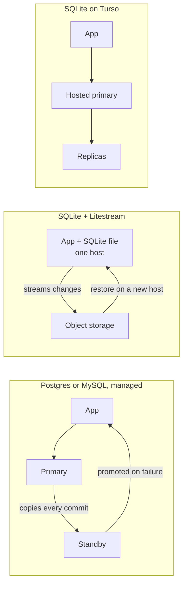

import { Explore, Question } from "kit";
import Opening from "./opening.mdx";
import { options } from "./db.ts";
import { loadFrame } from "./load.ts";
import "./colours.css";

# The database for a *multi-tenant* SaaS

Postgres meets the needs that matter most for 200 business customers: isolation the database enforces, failover, and reporting. Switch on what you need; the options that cannot give it fade.

<Opening />

## Load does not decide

Each option handles a small SaaS's writes on one machine. Move the sliders to see how far the load has to grow before SQLite's single writer is the limit.

<Explore label="Peak writes against one machine's ceiling" controls={[
	{ id: "customers", label: "Customers", range: [50, 2000, 50], value: 200 },
	{ id: "users", label: "Users per customer", range: [5, 100, 5], value: 20 },
	{ id: "rate", label: "Writes per active user per minute", range: [1, 30, 1], value: 6 },
]} frame={loadFrame} />

<b>Guessed</b>Ceilings are planning figures for small commits on a cloud SSD (SQLite in WAL mode, a modest Postgres or MySQL instance), not benchmarks. Measure your own workload before relying on them.

## What a failed host costs

The options differ in what happens when the machine dies, not in how fast they run.

Postgres and MySQL keep a standby that takes over. Litestream keeps a continuous backup, so a host failure means a restore, and writes after the last sync are lost ([Litestream](https://litestream.io/how-it-works/)). On Turso, the vendor runs the replication; read its terms for what it promises.

How would isolation work with one database per tenant?

Each customer gets its own SQLite file or Turso database, so one tenant can never read another's rows, and a customer's data is easy to export or delete. The cost is operational: every migration runs 200 times, and reports across customers need a separate store.

Postgres and MySQL can also give each tenant a schema, with the same migration cost. Postgres's row-level security keeps one shared schema and still has the database refuse cross-tenant reads ([PostgreSQL docs](https://www.postgresql.org/docs/current/ddl-rowsecurity.html)).

<section class="band">

## Pick a database

Postgres is recommended: it is the only option here that meets isolation, failover and migrations without a compromise. Switch to SQLite if a restore after an outage and a single host are acceptable for the first year.

<Question name="database" recommended="Postgres" note rows={options} cols={[
	{ head: "Option", value: "name" },
	{ head: "Wins when", value: "wins" },
	{ head: "Costs you", value: "costs" },
]} />

</section>

<section class="minor">

## Basis

The matrix is the page's own reading of the documentation: [row-level security in Postgres](https://www.postgresql.org/docs/current/ddl-rowsecurity.html), [implicit commits in MySQL](https://dev.mysql.com/doc/refman/8.4/en/implicit-commit.html), [SQLite's one writer in WAL mode](https://www.sqlite.org/wal.html), [when SQLite fits](https://www.sqlite.org/whentouse.html), [Litestream](https://litestream.io/how-it-works/) and [Turso](https://docs.turso.tech/). Product features change; check the version you will run.

</section>
