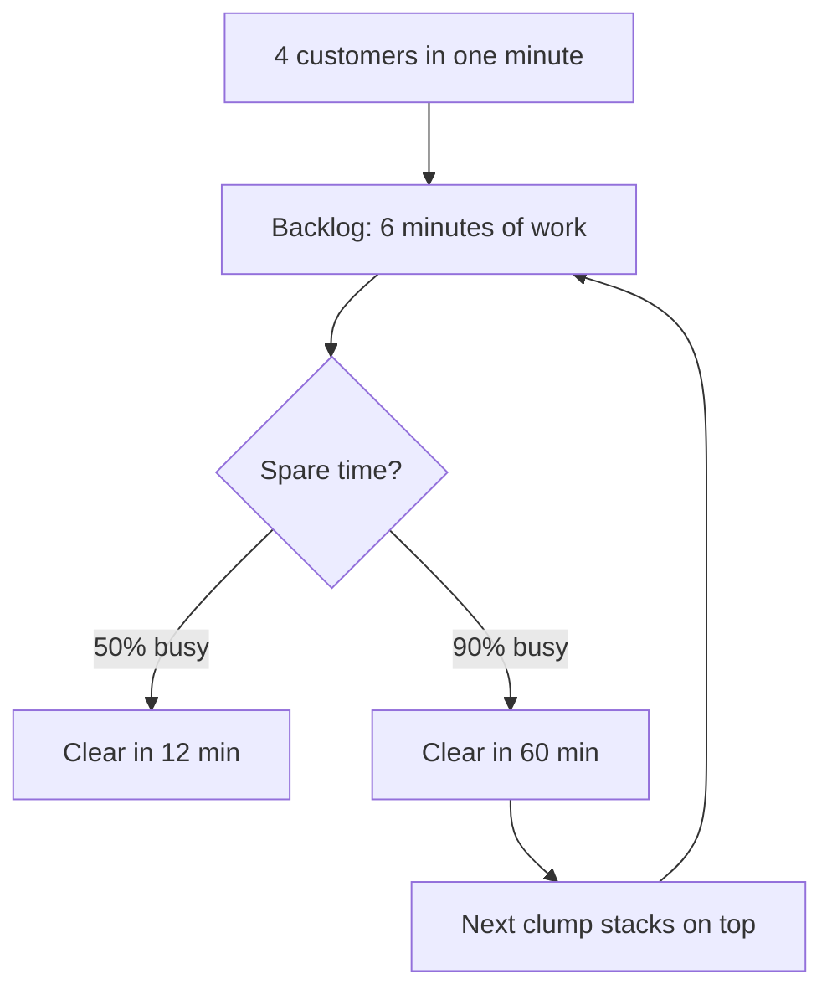

import { Question, View } from "kit";
import { fixList, fmt, replay } from "./cafe.ts";
import { Fixes, FixWeek, LoadCurve, Week } from "./figures.tsx";
import "./page.css";

{/* First screen: the answer, its numbers, and the one figure that shows it. */}

# At 90% busy, one barista means an *18-minute* wait. Add a second and it drops to 30 seconds.

Waiting barely grows until the last bit of slack disappears, then it explodes.

Simulated sample data

<LoadCurve />

<Week />

## Why one clump of customers costs an hour

<figure class="fig" id="mechanism" aria-label="How a backlog grows">

</figure>

{/* data-ref terms light the diagram part with the same Mermaid id (kit link.js). */}

1. Four customers walk in within the same minute. Random arrivals do this several times a day.
2. One is served, three wait: a backlog of 6 minutes on top of everyone who arrives next.
3. The backlog shrinks only in spare time, the minutes when nobody new is ordering.
4. At 50% busy every other minute is spare: the 6 minutes are gone in about 12.
5. At 90% busy one minute in ten is spare: the same backlog takes about an hour.
6. Within that hour the next clump arrives and stacks on top. That is where the 18-minute average comes from.

{/* The one band: the section where the reader compares fixes and answers. */}

<section class="band" id="fixes-section">

## Which fix buys back the most time at 90% busy?

<Fixes />

Exact values

{/* No control changes these rows, so the page renders them, not a client component: they show before scripts run and print. */}
<table class="compare">
<thead><tr><th>Fix</th><th class="num">Barista busy</th><th class="num">Average wait</th><th class="num">Saved</th></tr></thead>
<tbody>
{fixList.map((f) => (
	<tr data-state={f.id === "second" ? "fit" : f.id === "none" ? "out" : "maybe"}>
		<th scope="row"><a href={`#fix/${f.id}`}>{f.name}</a></th>
		<td class="num" data-label="Barista busy">{(f.busy * 100).toFixed(1)}%</td>
		<td class="num" data-label="Average wait">{fmt(f.wait)}</td>
		<td class="num" data-label="Saved">{Math.round((1 - f.wait / fixList[0].wait) * 100)}%</td>
	</tr>
))}
</tbody>
</table>

<b>Inferred</b>Fixes are modelled, not observed. A real second barista shares one espresso machine, so expect less than the formula promises.

{/* The decision the page ends in, asked on the page: the reply sends the answer and any notes back as Markdown. */}

<Question name="first-fix" legend="Which fix would you try first?" options={{ second: "Second barista", steady: "Steadier orders", faster: "Quicker orders", fewer: "Fewer customers" }} />

</section>

{/* Drill-down: one view per fix at #fix/<id>, its numbers computed when the page packs; the chart replays the week. */}

{fixList.map((f) => {
	const [before, after] = replay(f);
	const was = (text) => (f.id === "none" ? "" : `was ${text}`);
	return (
		<View name="fix" param={f.id} back="All fixes">
			<h1>{f.name}: the same week, replayed</h1>
			
{f.id === "none" ? "The baseline week every fix is compared with." : `Average wait goes from ${fmt(before.avg)} to ${fmt(after.avg)} on the same customers.`}

			<dl class="stats">
				
<dt>Average wait</dt><dd>{fmt(after.avg)} <small>{was(fmt(before.avg))}</small></dd>

				
<dt>Longest line</dt><dd>{after.peak} <small>{was(before.peak)}</small></dd>

				
<dt>Waited 10+ min</dt><dd>{after.long} <small>{was(`${before.long} customers`)}</small></dd>

			</dl>
			<figure class="fig">
				<FixWeek id={f.id} />
				<figcaption>Same customers arriving at the same moments, Monday to Friday at 90% busy. Click a legend entry to hide a line; zoom with the bar below.</figcaption>
			</figure>
		</View>
	);
})}
