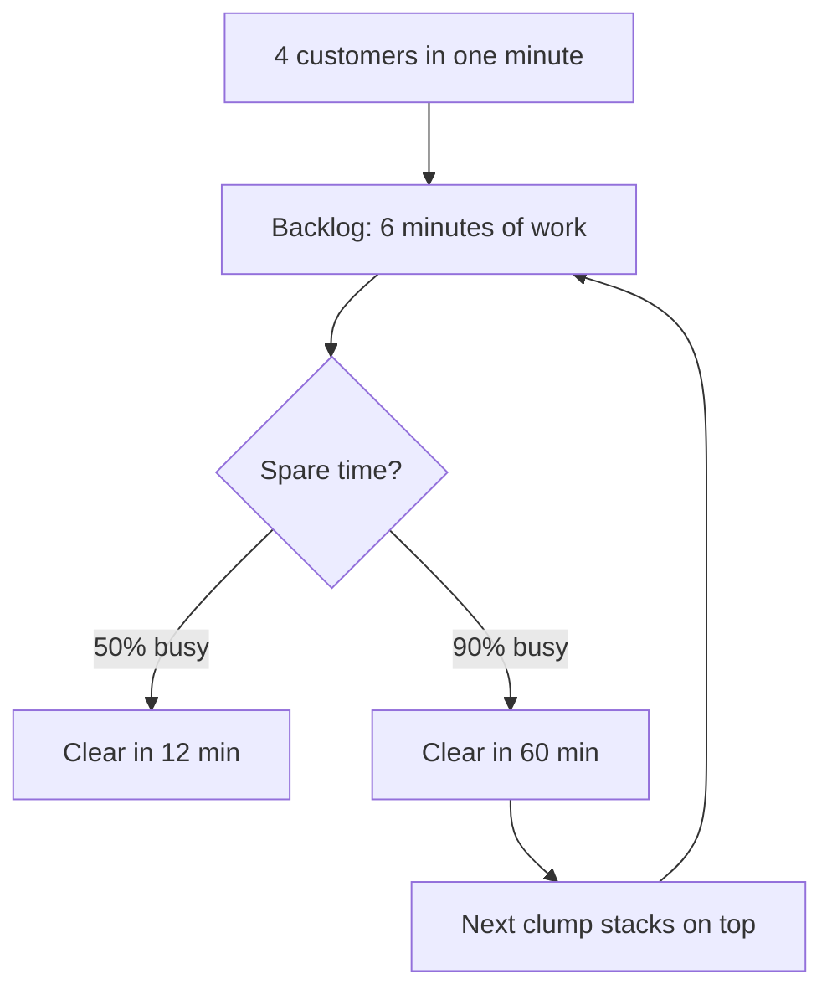

import { Explore, Plot, Question, Stepper, Table, View } from "kit";
import { baseline, curve, fixes, fmt, loadFrame } from "./cafe.ts";

{/* First screen: the answer, the line under it that orients, and the one figure that shows it. */}

# At 90% busy, one barista means an *18-minute* wait. A second barista cuts it to 30 seconds.

Waiting barely grows until the last bit of slack disappears, then it explodes. A queueing model of a café where customers arrive at random and orders take 2 minutes on average, some much longer, for deciding what to change first.

Illustrative model, not measured in a real café

{/* frame comes from a module without "use client", so pack computes every slider position and the page carries no model code. */}

<Explore label="Average wait against how busy the barista is" controls={[{ id: "load", label: "Barista busy", range: [50, 95, 1], value: 90, format: { unit: "%" } }]} frame={loadFrame} />

<h2 data-nav="Clumps">Why one clump of customers costs an hour</h2>

{/* data-ref terms light the diagram part with the same Mermaid id. */}

1. Four customers walk in within the same minute. Random arrivals do this several times a day.
2. One is served, three wait: a backlog of 6 minutes on top of everyone who arrives next.
3. The backlog shrinks only in spare time, the minutes when nobody new is ordering.
4. At 50% busy every other minute is spare: the 6 minutes are gone in about 12. At 90% one minute in ten is: the same backlog takes about an hour, and the next clump lands on top.

<h2 data-nav="Formula">Where the 18 minutes come from</h2>

{/* A derivation is a case where the order is the point, so it steps. Study pages start at step 1. */}

<Stepper start={1} label="The wait formula, one step at a time" captions={["How busy the barista is: customers per minute times minutes per order.", "A customer has to wait exactly as often as the barista is busy.", "Then they wait for the orders ahead: on average ρ/(1 − ρ) of them, 2 minutes each."]}>

$$\rho = \lambda S = 0.45\,/\text{min} \cdot 2\,\text{min} = 0.9$$

$$P(\text{wait}) = \rho = 0.9$$

$$W = \frac{\rho}{1 - \rho}\,S = \frac{0.9}{0.1} \cdot 2\,\text{min} = 18\,\text{min}$$

</Stepper>

<Question name="slower" legend="Orders take 3 minutes instead of 2, and the barista is still 90% busy. About how long is the wait?" options={["18 min", "27 min", "40 min"]} answer="27 min">

Busy is still 0.9, so the average customer still finds $\frac{0.9}{0.1} = 9$ orders ahead; at 3 minutes each that is 27 minutes.

</Question>

<section class="band">

<h2 data-nav="Fixes">A second barista saves 97% of the wait; every other fix saves about half</h2>

<Plot label="Average wait at 90% busy for each fix" option={{ categories: fixes.map((f) => f.name), horizontal: true, series: [{ name: "Average wait", type: "bar", data: fixes.map((f) => f.wait), label: { digits: 1, unit: "min" } }], x: { format: { unit: "min" } } }} />

{/* One record per row, computed from the model; each name opens that fix's view. */}

<Table rows={fixes} state={(f) => (f.id === "second" ? "fit" : f.id === "none" ? "out" : "maybe")} cols={[{ head: "Fix", value: "name", link: (f) => `#fix/${f.id}` }, { head: "Barista busy", value: "busy", format: { percent: true } }, { head: "Average wait", value: "wait", format: { digits: 1, unit: "min" } }, { head: "Saved", value: "saved", format: { percent: true } }]} />

<b>Inferred</b>Fixes are modelled, not observed: each view says what the model leaves out.

{/* The decision the page ends in, asked on the page: the reply sends the answer and any notes back as Markdown. */}

<Question name="first-fix" legend="Which fix would you try first?" options={{ second: "Second barista", steady: "Steadier orders", faster: "Quicker orders", fewer: "Fewer customers" }} />

</section>

<section class="minor">

## Formulas

| Queue | Average wait before ordering | Symbols |
|---|---|---|
| One barista (M/M/1) | $W = \frac{\rho}{1 - \rho}\,S$ | $\rho = \lambda S$, the share of time busy; $\lambda$ customers per minute; $S$ = 2 min per order |
| Every order the same (M/D/1) | $W = \frac{\rho}{2(1 - \rho)}\,S$ | as above |
| Two baristas (M/M/2) | $W = \frac{2\rho^2}{1 + \rho} \cdot \frac{S}{2(1 - \rho)}$ | $\rho = \lambda S / 2$, each barista's share |

</section>

{/* A few records, so one static view each at #fix/<id>: in the page, printed, and computed when it packs. */}

{fixes.map((f) => (
	<View name="fix" param={f.id} back="All fixes">
		<h1>{f.name}: {fmt(f.wait)} average wait at 90% busy</h1>
		
{f.note}

		<section>
			<h2>Under 10 minutes up to {f.upTo}% busy</h2>
			<Plot label={`Average wait with ${f.name}, against changing nothing`} option={{ series: [{ name: "Change nothing", data: baseline, color: "var(--bad)" }, ...(f.id === "none" ? [] : [{ name: f.name, data: curve(f), color: "var(--ok)" }])], x: { format: { unit: "%" } }, y: { min: 0, max: 40, format: { unit: "min" } } }} />
		</section>
	</View>
))}
