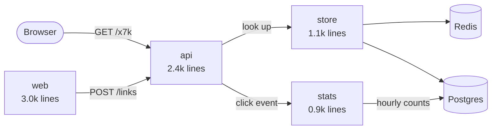
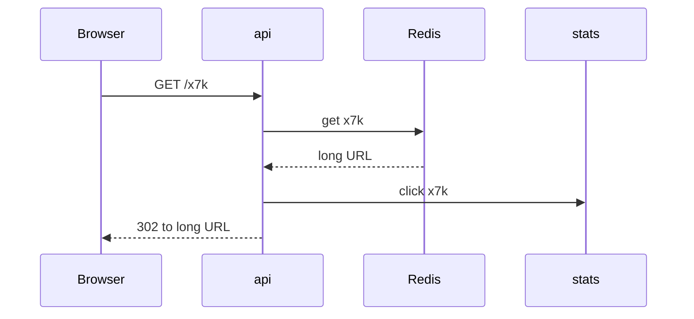
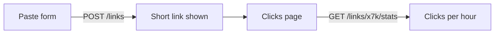
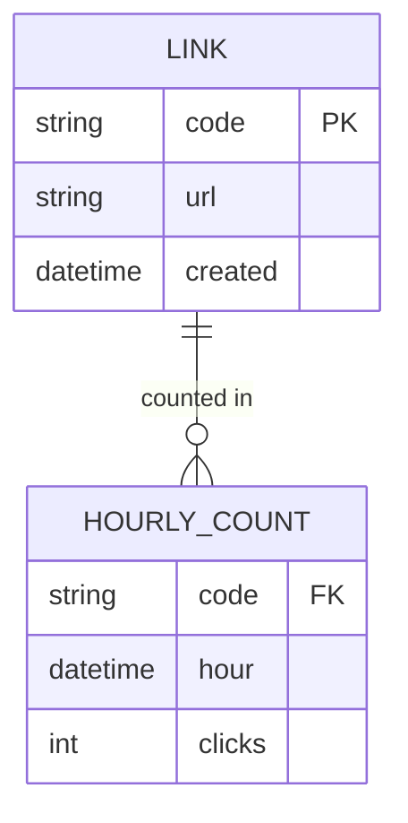
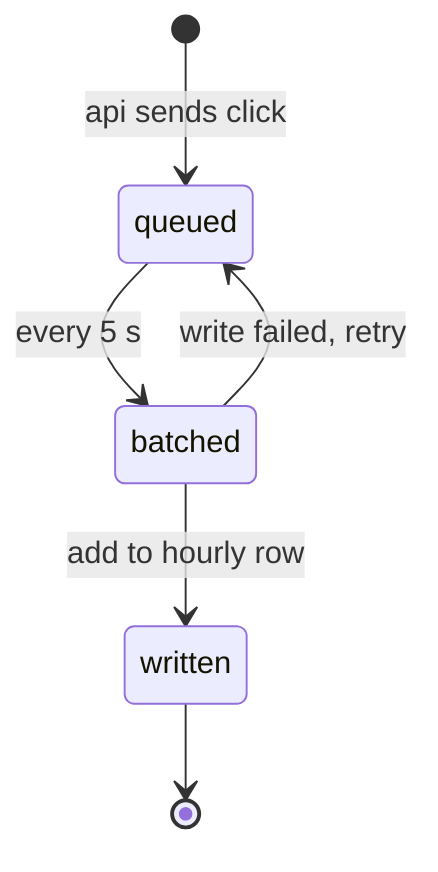

import { Plot, Stepper, View } from "kit";
import { batches, hitRate, redirect } from "./snip.ts";

{/* A system tour: the map of the whole first, one drawn walkthrough, then each part in a view that opens with its own figure. */}

# Snip: a link shortener in four packages

Paste a long link, get a short one, and see how often it was clicked.

## The whole system

{/* List first, the map second: each item and its node share a data-ref, and the name opens that part's view. */}

- 1 [web](#part/web): the page where people paste a link and watch its clicks.
- 2 [api](#part/api): answers every request, and keeps a redirect to about 2 ms.
- 3 [store](#part/store): links in Postgres, the busy ones in a Redis cache.
- 4 [stats](#part/stats): counts clicks in batches, off the redirect's path.

## One click

{/* The walkthrough follows one real request; each step lights the messages it names. */}

<Stepper start={1} label="One redirect, step by step" refs={["m1", "m2", "m3", "m4", "m5"]} captions={["A reader opens snip.to/x7k: the api gets the code x7k.", "The api asks the store, which tries Redis first.", "Redis holds x7k (94% of redirects): 1.2 ms. A miss goes on to Postgres: 9.8 ms.", "The click is queued for stats in 0.2 ms; counting it waits for the next batch.", "The reader is sent on with a 302, about 2 ms after asking."]}>

</Stepper>

## Packages

{/* The register is reference behind the tour, not its spine. */}

| Package | Lines | Entry | Tests |
|---|---:|---|---:|
| [web](#part/web) | 3,020 | `web/src/main.tsx` | 41 |
| [api](#part/api) | 2,410 | `api/server.ts` | 88 |
| [store](#part/store) | 1,130 | `store/index.ts` | 37 |
| [stats](#part/stats) | 910 | `stats/worker.ts` | 19 |

<View name="part" param="web" back="Snip">

# web: one form and one chart

The only package a person sees.

## Two screens

The form and the report call the api only; web never reads the database.

</View>

<View name="part" param="api" back="Snip">

# api: four stages per request

Every redirect passes the same stages; only the look-up's time depends on the cache.

## Where 2 ms go

<Plot label="Milliseconds per api stage of one redirect" option={{ categories: redirect.stages, horizontal: true, series: [{ name: "Cache hit", type: "bar", data: redirect.hit, fill: "accent", label: { digits: 1, unit: "ms" } }, { name: "Cache miss", type: "bar", data: redirect.miss, fill: "hollow", label: { digits: 1, unit: "ms" } }], x: { format: { unit: "ms" } } }} />

A miss costs five times a hit, all of it in the look-up: the store is where speed is won.

</View>

<View name="part" param="store" back="Snip">

# store: two tables behind a cache

Links are written once and read thousands of times, so reads go to Redis first.

## The data

## How big the cache is

<Plot label="Share of redirects Redis answers, by links it holds" option={{ series: [{ name: "Hit rate", data: hitRate, color: "var(--accent)" }], x: { name: "links held", format: { unit: "k" } }, y: { min: 0.5, max: 1, format: { percent: true } }, marks: [{ x: 100, label: "today: 94%" }] }} />

Past 100,000 links the cache gains little: most clicks go to recent links.

</View>

<View name="part" param="stats" back="Snip">

# stats: clicks counted in batches

A click is queued by the api and written later, one row per link and hour.

## A click's life

## Load over a day

<Plot label="Clicks per 5-second batch on a weekday" option={{ categories: batches.hours.map((h) => `${h}:00`), series: [{ name: "Clicks per batch", type: "bar", data: batches.clicks, fill: batches.clicks.map((c) => (c === Math.max(...batches.clicks) ? "accent" : "")), label: true }] }} />

Even the noon peak is one write of 520 clicks every 5 seconds, well within one Postgres connection.

</View>
