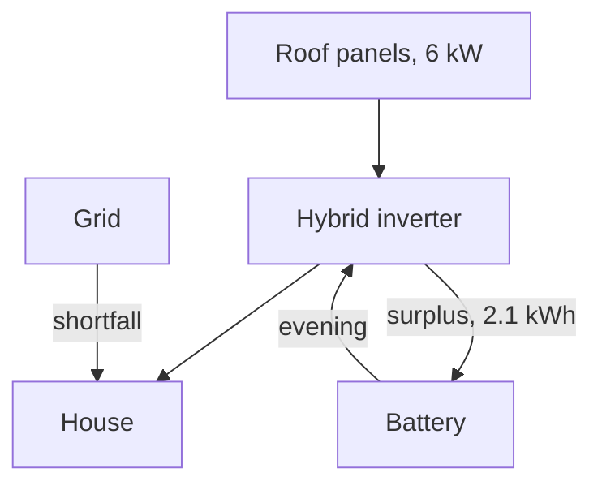
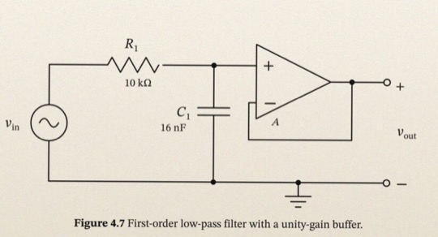
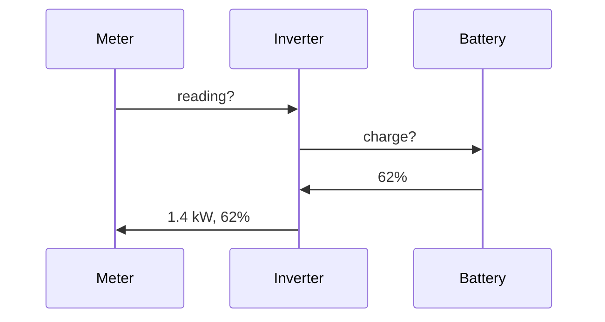

import { Chart, Explore, Plot, Question, Recall, Records, Stepper, Term, View } from "kit";
import { euro, MONTHS, month, PRODUCTION, payback, quote, SIZE_ROWS, SIZES, supplier, USE } from "./data.ts";
import { Day } from "./day.tsx";
import { CHARGE, JULY } from "./july.ts";
import "./page.css";

# A 5 kWh battery carries *80% of summer evenings*; doubling it adds 9 points for 3,700 € more.

What size of battery to add to a 6 kW rooftop array on a four-person house, from an installer's quote and a year of meter readings.

**Decide:** pick one of the three sizes in the question below, a minute.

Illustrative numbers, not a real quote

<figure class="fig">
<Plot label="Years until each battery size pays for itself" option={{ categories: SIZES.map((s) => s.name), horizontal: true, series: [{ name: "Payback", type: "bar", data: SIZES.map(payback), label: true }], marks: [{ x: 15, label: "cells last 15 years" }], x: { name: "years", max: 20 } }} />
<figcaption>Years until the battery has paid for itself at today's prices. <a href="#method">How the numbers were made</a></figcaption>
</figure>

<h2 data-nav="Year">The panels make four times more in July than in December</h2>

<figure class="fig">
<Chart label="Monthly production and use" option={{ grid: { top: 40, left: 8, right: 16, bottom: 8 }, legend: { top: 8, left: 8 }, tooltip: { trigger: "axis" }, xAxis: { type: "category", data: MONTHS }, yAxis: { type: "value", axisLabel: { formatter: "{value} kWh" } }, series: [{ name: "Produced", type: "bar", color: "var(--accent)", data: PRODUCTION }, { name: "Used", type: "line", color: "var(--ink)", data: USE }] }} />
<figcaption>From April to September the roof makes more than the house uses; a battery only moves that surplus into the evening.</figcaption>
</figure>

<Explore label="Production and use in the month picked" controls={[{ id: "month", label: "Month", choice: MONTHS, value: "Jul", axis: true }]} frame={month} />


<h2 data-nav="Day">On a summer day the battery is full by early afternoon</h2>

<Plot label="A July day: what the roof makes and the house uses, and what the battery moves to the evening" option={JULY} />

<Plot label="How fast the battery charges at each charger, until it is full at 10 kWh" option={CHARGE} />

<Day />

<h2 data-nav="Flow">Where the energy goes</h2>

<Stepper start={1} label="Energy flow through the day" captions={["Morning: the panels run the house directly.", "Midday: the surplus charges the battery.", "Evening: the battery runs the house.", "Night: once it is empty, the grid takes over."]}>
<svg class="flow" viewBox="0 0 360 150" role="img" aria-label="Panels, battery, house and grid">
<rect x="10" y="10" width="100" height="40" rx="4" /><text x="60" y="35">Panels</text>
<rect x="250" y="10" width="100" height="40" rx="4" /><text x="300" y="35">House</text>
<rect x="130" y="95" width="100" height="40" rx="4" /><text x="180" y="120">Battery</text>
<rect x="250" y="95" width="100" height="40" rx="4" /><text x="300" y="120">Grid</text>
<g data-step="1"><path d="M110 30 H250" /></g>
<g data-step="2"><path d="M60 50 V115 H130" /></g>
<g data-step="3"><path d="M210 95 L265 50" /></g>
<g data-step="4"><path d="M300 95 V50" /></g>
</svg>
</Stepper>

<h2 data-nav="System">The battery sits behind the inverter</h2>

<Explore controls={[{ id: "hour", label: "Time of day", choice: { morning: "Morning", evening: "Evening", night: "Night" } }]} frame={supplier} />

<div class="beside" data-width="full">

- <span data-ref="panels">1</span> The <span data-ref="panels">panels</span> stay as they are.
- <span data-ref="inverter">2</span> The <span data-ref="inverter">hybrid inverter</span> replaces the string inverter and decides where each kWh goes.
- <span data-ref="battery">3</span> The <span data-ref="battery">battery</span> takes the surplus and gives it back in the evening.
- <span data-ref="grid">4</span> The <span data-ref="grid">grid</span> covers what is left, through a new bidirectional meter.




</div>

The status lamp on the inverter is wired like this:

```schematic
title Status lamp: a 12 V supply, a series resistor and an LED
VB battery vcc 0 12 V @0,0 v
R_lim resistor vcc lamp 680 a@VB.a 6,0 v
D1 led lamp 0 green b@R_lim.b 0,4 v
```

The <span data-ref="R_lim">series resistor</span> sets the lamp's current, about 16 mA.

<figure>

<figcaption>A textbook-style scan of a low-pass filter for the inverter's signal path.</figcaption>
</figure>

<h2 data-nav="Meter">The meter reads the inverter every minute</h2>

<Stepper start={1} label="One meter reading" captions={["The meter asks the inverter for a reading.", "The inverter asks the battery for its charge.", "The battery answers.", "The inverter answers, and the reading goes into the log."]} refs={["m1", "m2", "m3", "m4 logged"]}>



</Stepper>

Each reading ends up in the <span data-ref="logged">meter log</span>.

<h2 data-nav="Cost">The 5 kWh quote is 4,200 €, two thirds of it the battery</h2>

<Records {...quote("Item", "Price")} refField="ref" />

<h2 data-nav="Options">Three sizes, one decision</h2>

<ul>
{SIZES.map((s) => (
	<li><a href={`#size/${s.id}`}>{s.name}</a>: {euro(s.price)}, {Math.round(s.evenings * 100)}% of summer evenings, pays back in {payback(s)} years</li>
))}
</ul>

<section class="band">

## Which size would you buy?

<Question name="size" rows={SIZE_ROWS} recommended="5 kWh" cols={[{ head: "Size", value: "size" }, { head: "Price", value: "price", format: { currency: "EUR" } }, { head: "Saves a year", value: "saved", format: { currency: "EUR" } }, { head: "Paid back in", value: "back", format: { unit: "years" } }, { head: "Summer evenings carried to midnight", value: "evenings", format: { percent: true } }]} />

</section>

## How much energy does the charger deliver in half an hour at 2.4 kW?

<Question name="energy" legend="Energy delivered" answer={1.2} tolerance={0.01} unit="kWh">

Multiply 2.4 kW by 0.5 h to get **1.2 kWh**.

</Question>

{SIZES.map((s) => (
	<View name="size" param={s.id} back="Battery options">
		<h1>{s.name}: {euro(s.price)}</h1>
		<p>{s.note}</p>
		<dl class="stats">
			<div class="stat"><dt>Summer evenings</dt><dd>{Math.round(s.evenings * 100)}%</dd></div>
			<div class="stat"><dt>Saved a year</dt><dd>{euro(s.saved)}</dd></div>
			<div class="stat"><dt>Payback</dt><dd>{payback(s)} <small>years</small></dd></div>
		</dl>
		<section>
			<h2>Share of each month's use the house covers itself</h2>
			<Plot label={`Self-sufficiency by month with ${s.name}`} option={{ categories: MONTHS, series: [{ name: "Covered", type: "bar", data: s.selfSufficiency.map((v) => Math.round(v * 100)) }], y: { min: 0, max: 100, name: "%" } }} />
		</section>
	</View>
))}

<View name="method" back="Battery options">

# How the numbers were made

<div class="beside">
<div>

A year of hourly meter readings, scaled to the quote's battery sizes with a simple charge model: each hour the <span data-ref="surplus">surplus</span> charges the battery up to its size, losing a tenth on the way (its <Term recall="round-trip">round trip</Term>), and a shortfall draws it down before the grid is asked.

</div>

```ts ref:surplus="surplus"
for (const hour of year) {
	const surplus = hour.produced - hour.used;
	stored = surplus > 0
		? Math.min(size, stored + surplus * 0.9)
		: Math.max(0, stored + surplus);
}
```

</div>

## Assumptions

| Input | Value |
| --- | --- |
| Array | 6 kW, south, 35° |
| Use | 4,920 kWh a year |
| Bought | 0.22 €/kWh |
| Sold | 0.06 €/kWh |
| Battery round trip | 90% |

## Not included

Price changes, battery wear after year ten, and any subsidy, which would shorten the <Term recall="payback">payback</Term>.

<Recall id="round-trip">A battery's **round trip** is the share of the energy put in that comes back out, here 90%.</Recall>

<Recall id="payback">The **payback** time is the price over the yearly saving: the years until the battery has paid for itself.</Recall>

</View>
