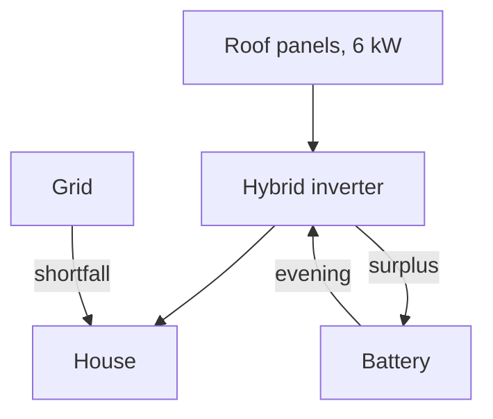

import { Chart, Plot, Question, Records, Stepper, View } from "kit";
import { euro, MONTHS, PRODUCTION, payback, quote, SIZES, USE } from "./data.ts";
import { Day } from "./day.tsx";
import "./page.css";

# A 5 kWh battery carries *80% of summer evenings*; doubling it adds 9 points for 3,700 € more.

What size of battery to add to a 6 kW rooftop array on a four-person house, from an installer's quote and a year of meter readings.

Illustrative numbers, not a real quote

<figure class="fig">
<Plot label="Years until each battery size pays for itself" option={{ categories: SIZES.map((s) => s.name), horizontal: true, series: [{ name: "Payback", type: "bar", data: SIZES.map(payback), label: true }], x: { name: "years" } }} />
<figcaption>Years until the battery has paid for itself at today's prices. <a href="#method">How the numbers were made</a></figcaption>
</figure>

<h2 data-nav="Year">The panels make four times more in July than in December</h2>

<figure class="fig">
<Chart label="Monthly production and use" option={{ grid: { top: 40, left: 8, right: 16, bottom: 8 }, legend: { top: 8, left: 8 }, tooltip: { trigger: "axis" }, xAxis: { type: "category", data: MONTHS }, yAxis: { type: "value", axisLabel: { formatter: "{value} kWh" } }, series: [{ name: "Produced", type: "bar", color: "var(--accent)", data: PRODUCTION }, { name: "Used", type: "line", color: "var(--ink)", data: USE }] }} />
<figcaption>From April to September the roof makes more than the house uses; a battery only moves that surplus into the evening.</figcaption>
</figure>

<h2 data-nav="Day">On a summer day the battery is full by early afternoon</h2>

<Day />

<h2 data-nav="Flow">Where the energy goes</h2>

<Stepper start={1} label="Energy flow through the day" captions={["Morning: the panels run the house directly.", "Midday: the surplus charges the battery.", "Evening: the battery runs the house.", "Night: once it is empty, the grid takes over."]}>
<svg class="flow" viewBox="0 0 360 150" role="img" aria-label="Panels, battery, house and grid">
<rect x="10" y="10" width="100" height="40" rx="4" /><text x="60" y="35">Panels</text>
<rect x="250" y="10" width="100" height="40" rx="4" /><text x="300" y="35">House</text>
<rect x="130" y="95" width="100" height="40" rx="4" /><text x="180" y="120">Battery</text>
<rect x="250" y="95" width="100" height="40" rx="4" /><text x="300" y="120">Grid</text>
<g data-step="1"><path d="M110 30 H250" /></g>
<g data-step="2"><path d="M60 50 V115 H130" /></g>
<g data-step="3"><path d="M210 95 L265 50" /></g>
<g data-step="4"><path d="M300 95 V50" /></g>
</svg>
</Stepper>

<h2 data-nav="System">The battery sits behind the inverter</h2>

- The panels stay as they are.
- The hybrid inverter replaces the string inverter and decides where each kWh goes.
- The battery takes the surplus and gives it back in the evening.
- The grid covers what is left, through a new bidirectional meter.

<h2 data-nav="Cost">The 5 kWh quote is 4,200 €, two thirds of it the battery</h2>

<Records {...quote("Item", "Price")} refField="ref" />

<h2 data-nav="Options">Three sizes, one decision</h2>

<ul>
{SIZES.map((s) => (
	<li><a href={`#size/${s.id}`}>{s.name}</a>: {euro(s.price)}, {Math.round(s.evenings * 100)}% of summer evenings, pays back in {payback(s)} years</li>
))}
</ul>

<section class="band">

## Which size?

<Question name="size" legend="Which size would you buy?" options={Object.fromEntries(SIZES.map((s) => [s.id, s.name]).concat([["none", "None yet"]]))} />

</section>

{SIZES.map((s) => (
	<View name="size" param={s.id} back="Battery options">
		<h1>{s.name}: {euro(s.price)}</h1>
		
{s.note}

		<dl class="stats">
			
<dt>Summer evenings</dt><dd>{Math.round(s.evenings * 100)}%</dd>

			
<dt>Saved a year</dt><dd>{euro(s.saved)}</dd>

			
<dt>Payback</dt><dd>{payback(s)} <small>years</small></dd>

		</dl>
		<section>
			<h2>Share of each month's use the house covers itself</h2>
			<Plot label={`Self-sufficiency by month with ${s.name}`} option={{ categories: MONTHS, series: [{ name: "Covered", type: "bar", data: s.selfSufficiency.map((v) => Math.round(v * 100)) }], y: { min: 0, max: 100, name: "%" } }} />
		</section>
	</View>
))}

<View name="method" back="Battery options">

# How the numbers were made

A year of hourly meter readings, scaled to the quote's battery sizes with a simple charge model.

## Assumptions

| Input | Value |
| --- | --- |
| Array | 6 kW, south, 35° |
| Use | 4,920 kWh a year |
| Bought | 0.22 €/kWh |
| Sold | 0.06 €/kWh |
| Battery round trip | 90% |

## Not included

Price changes, battery wear after year ten, and any subsidy.

</View>
