# Mermaid stress fixtures

Diagrams that break naive layouts. Generated by build/mermaid-compare.ts --page from the .mmd files beside it.

## 01-task-plan

A release plan in the reported shape: eight tasks feed one, solid and dashed mixed, loose tasks, a rework loop.

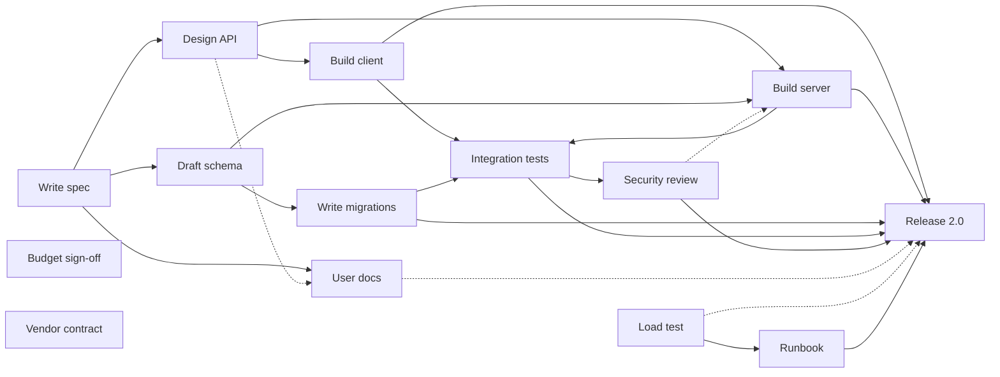

## 02-fan-out

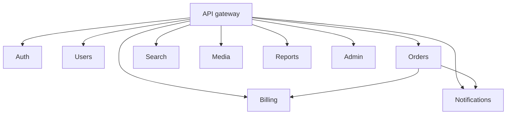

## 03-mixed-fan-in

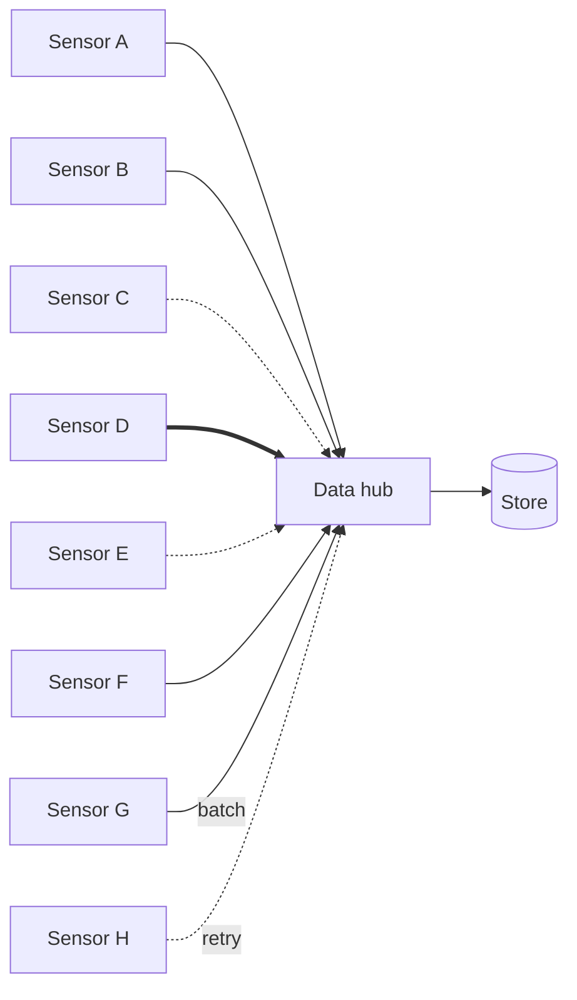

## 04-disconnected

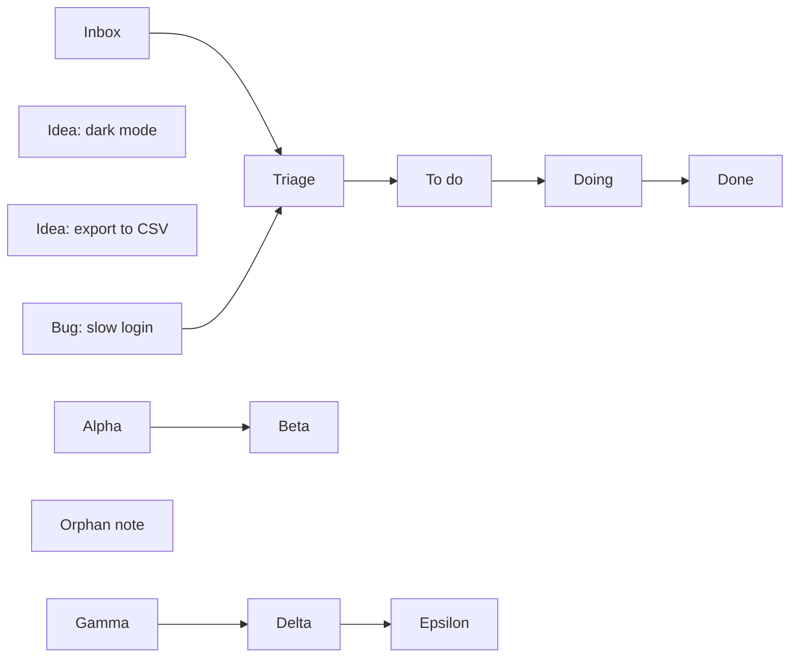

## 05-skip-edges

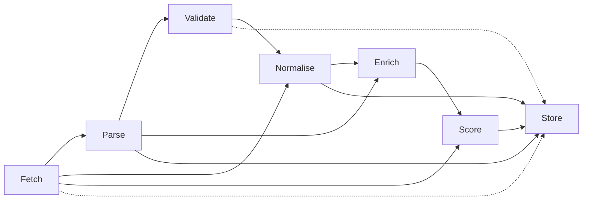

## 06-cycles

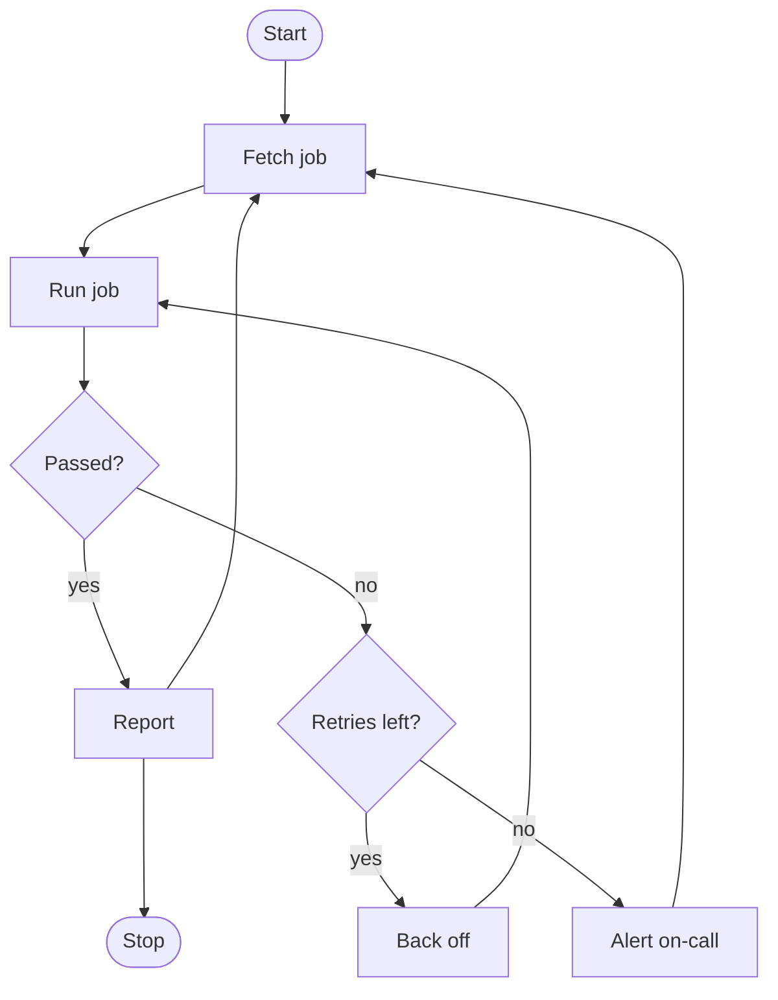

## 07-subgraphs

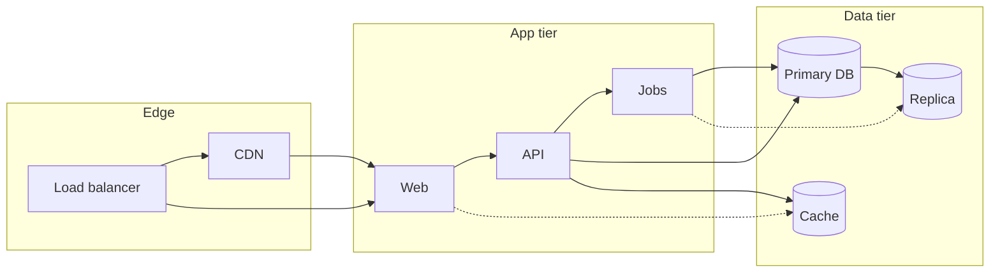

## 08-wide-lr

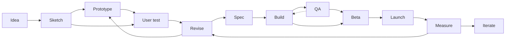

## 09-td-labels

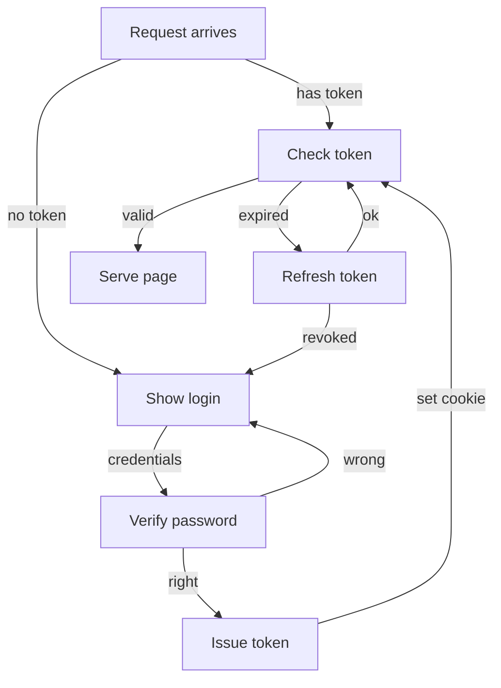

## 10-state

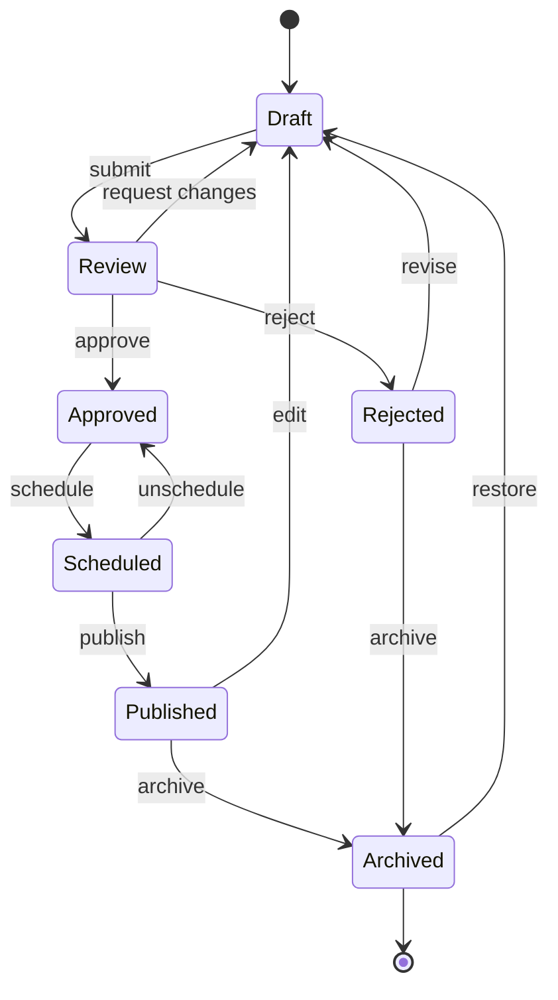

## 11-sequence

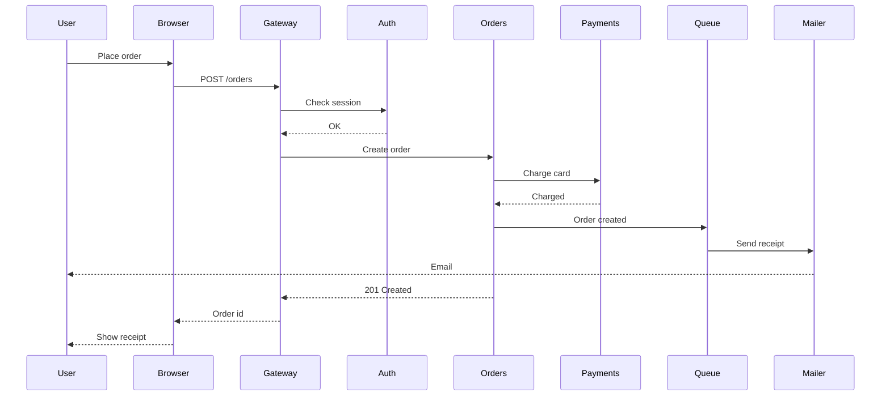
